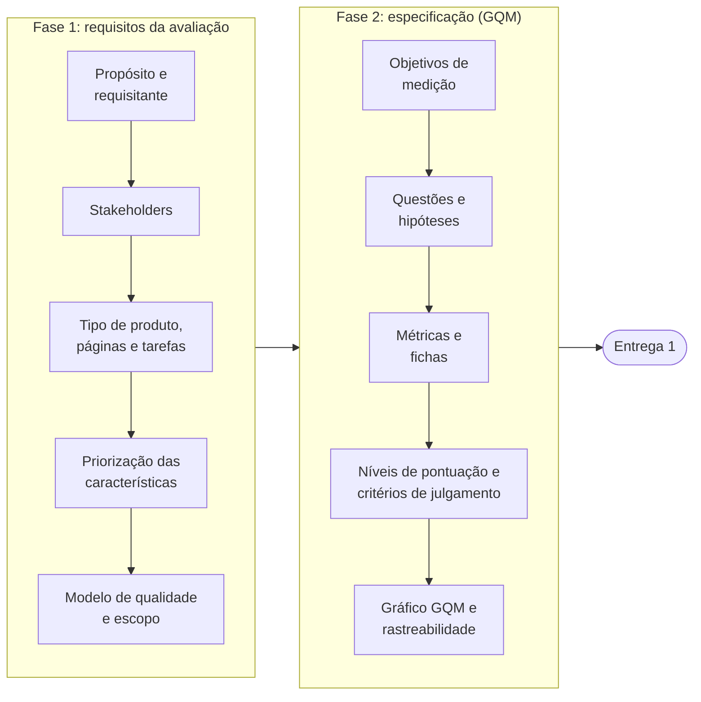

# Metodologia

Esta seção descreve como o trabalho foi conduzido: o tipo de avaliação, as etapas seguidas em
cada fase, a forma como a equipe se organizou e as ferramentas que usou. A Entrega 1 cobre as
Fases 1 e 2 do processo de avaliação de produto; as Fases 3 e 4 serão descritas na Entrega 2.

## Tipo de pesquisa e de avaliação

O trabalho é uma avaliação de produto de software **externa**, do tipo **caixa-preta**: a
equipe não tem vínculo com o desenvolvimento do SIT nem acesso a código, servidores ou dados de
uso, e todas as observações são feitas na área pública do portal, a partir do navegador. O MDA
é tratado como **requisitante simulado**, cujas decisões orientam o que a avaliação precisa
responder.

A condução segue o processo de avaliação de produto da série SQuaRE, em quatro fases (RAMOS,
2026c), com o modelo de qualidade de produto da ISO/IEC 25010:2023 (ISO/IEC, 2023). Na Fase 2,
a especificação da avaliação usa a abordagem GQM (BASILI; CALDIERA; ROMBACH, 1994).

## Etapas

*Figura 1: Etapas das Fases 1 e 2.*

### Fase 1: estabelecer os requisitos da avaliação

1. **Propósito:** definição do requisitante, do objetivo da avaliação (indicar pontos de
   melhoria) e das três decisões que os resultados devem apoiar: redesenho de interface,
   otimização de desempenho e cobertura de ambientes de teste.
2. **Stakeholders:** identificação de seis grupos, com papel, necessidade e critério de sucesso
   de cada um.
3. **Tipo de produto:** inspeção da área pública do portal em 19/10/2026 para descrever as
   seções, os usuários, o ambiente de uso e os requisitos de hardware e software. Dessa inspeção
   saíram as cinco páginas e as três tarefas avaliadas (T1: consultar um território; T2: ativar
   uma camada no mapa; T3: baixar um documento do território).
4. **Priorização:** as nove características da ISO/IEC 25010:2023 foram pontuadas em uma matriz
   de decisão ponderada, com três critérios (impacto no propósito e nos stakeholders, 45%; risco
   contextual de falha, 30%; viabilidade da avaliação, 25%). Só puderam ser escolhidas
   características com viabilidade de pelo menos 3. Foram selecionadas as três de maior
   pontuação: capacidade de interação, eficiência de desempenho e flexibilidade.
5. **Modelo de qualidade e escopo:** cada subcaracterística das características selecionadas foi
   procurada no portal. Foram mantidas as observáveis em uma avaliação caixa-preta, e as demais
   foram registradas como fora do escopo, com o efeito de cada exclusão na validade dos
   resultados.

### Fase 2: especificar a avaliação com o GQM

1. **Objetivos:** cada característica priorizada gerou um objetivo, descrito com o *template*
   do GQM (analisar, propósito, foco, ponto de vista e contexto) e com um *abstraction sheet*
   (RAMOS, 2026a). Cada objetivo ficou com um responsável.
2. **Questões e hipóteses:** cada subcaracterística mantida na Fase 1 gerou ao menos uma
   questão, num total de 13. Para cada questão, a equipe registrou a hipótese, isto é, a
   resposta esperada antes da medição. As hipóteses de eficiência de desempenho se apoiaram em
   uma medição piloto feita em 20/10/2026 com o Lighthouse, com cinco execuções por página.
3. **Métricas:** as 19 métricas partem das medidas da ISO/IEC 25023 (ISO/IEC, 2011b) sempre que
   a medida da norma se aplica a um portal web. Quando não se aplica, a ficha da métrica registra
   a adaptação. Cada ficha documenta definição, procedimento de cálculo, fonte dos dados,
   procedimento de coleta e critério de interpretação.
4. **Níveis de pontuação e critérios de julgamento:** uma escala comum de quatro níveis foi
   definida para todas as métricas, com limites tirados da literatura sempre que possível (por
   exemplo, as faixas do SUS e os limites de tempo de resposta), e com regras para consolidar as
   pontuações por característica.
5. **Gráfico GQM e rastreabilidade:** a hierarquia completa foi representada em um gráfico, e a
   ligação de cada objetivo com a Fase 1 foi conferida nos dois sentidos, como descrito abaixo.

## Rastreabilidade entre as fases

A Fase 2 deriva diretamente das decisões da Fase 1. O foco de cada objetivo sai das
características priorizadas e das subcaracterísticas mantidas no modelo adaptado. O ponto de
vista sai dos stakeholders. O propósito sai das decisões do requisitante. A Tabela 1 resume essa
ligação.

| Objetivo GQM | Característica (prioridade) | Decisão do requisitante | Ponto de vista (stakeholder) | Questões |
|---|---|---|---|---|
| G1 | Capacidade de interação (1ª) | Quais telas e fluxos redesenhar | Usuários do portal: colegiados e agentes territoriais, agricultores familiares e cidadãos | Q1.1 a Q1.6, uma por subcaracterística |
| G2 | Flexibilidade (3ª) | Quais ambientes entram na matriz de testes | Equipe de desenvolvimento e TI do SIT | Q2.1 a Q2.3 (adaptabilidade) |
| G3 | Eficiência de desempenho (2ª) | Se é preciso otimizar para conexões móveis | Requisitante (MDA) | Q3.1 a Q3.4 (comportamento temporal e utilização de recursos) |

*Tabela 1: Rastreabilidade da Fase 1 para a Fase 2.*

A verificação confirmou que as três decisões do requisitante e as nove subcaracterísticas
mantidas têm correspondência na Fase 2. Também confirmou que nenhuma questão ou métrica trata
de algo excluído do escopo. A tabela completa, com contexto de uso e ODS, está na
[Fase 2](../fase-2/index.md#rastreabilidade-entre-a-fase-1-e-a-fase-2).

## Organização da equipe

A equipe tem seis integrantes e trabalhou com as seguintes práticas:

- **Reuniões semanais presenciais**, registradas em ata no repositório. A reunião de 07/10
  organizou o trabalho da Entrega 1 em issues e criou o projeto do artigo. A de 14/10
  distribuiu as tarefas e criou o quadro kanban.
- **Uma issue por tarefa**, aberta a partir dos critérios da rubrica do enunciado. Cada issue
  traz os critérios que atende, um critério de pronto e um responsável.
- **Quadro kanban** no GitHub, com as colunas *Backlog*, *Ready*, *In progress*, *In review* e
  *Done*, e uma milestone por fase.
- **Fluxo por *pull request***: cada tarefa é feita em uma *branch* própria e entra na *branch*
  principal por um PR, que publica a GitPage automaticamente após o merge.
- **Acompanhamento entre reuniões** por um grupo de mensagens da equipe, com o GitHub como
  registro oficial de responsáveis, status e prazos.
- **Duas versões do texto:** a GitPage guarda o conteúdo completo e as evidências, e o artigo,
  escrito em LaTeX no modelo da SBC, apresenta a versão resumida.

O acompanhamento do andamento do projeto com métricas PSM/CID é documentado na GitPage, no
[Plano de Medição](../gestao/plano-medicao.md) e no
[Registro Semanal das Medições](../gestao/registro-medicoes.md).

## Ferramentas utilizadas

| Ferramenta | Uso |
|---|---|
| GitHub (issues, projects, milestones e pull requests) | Versionamento, distribuição e acompanhamento das tarefas |
| GitHub Actions | Publicação da GitPage e coleta diária dos dados do kanban |
| MkDocs Material | Geração da GitPage |
| Overleaf (LaTeX, modelo da SBC) | Escrita do artigo |
| Mermaid | Diagramas da GitPage (modelo de qualidade, gráfico GQM, fluxos) |
| Google Lighthouse | Medição piloto de eficiência de desempenho |
| Navegador (Google Chrome) | Inspeção do portal e registro das páginas e tarefas avaliadas |

*Tabela 2: Ferramentas usadas na Entrega 1.*

---

## Referências

BASILI, V. R.; CALDIERA, G.; ROMBACH, H. D. The goal question metric approach. In: MARCINIAK, J. J. (ed.). **Encyclopedia of software engineering**. New York: Wiley, 1994. p. 528-532.

INTERNATIONAL ORGANIZATION FOR STANDARDIZATION; INTERNATIONAL ELECTROTECHNICAL COMMISSION. **ISO/IEC WD 25023**: systems and software engineering — systems and software quality requirements and evaluation (SQuaRE) — measurement of system and software product quality. Working Draft, version 0.1.0. Genebra: ISO, 2011b.

INTERNATIONAL ORGANIZATION FOR STANDARDIZATION; INTERNATIONAL ELECTROTECHNICAL COMMISSION. **ISO/IEC 25010:2023**: systems and software engineering — systems and software quality requirements and evaluation (SQuaRE) — product quality model. 2. ed. Genebra: ISO, 2023.

RAMOS, C. S. **Medição baseada em objetivos**: determinando o que medir. Notas de aula da disciplina Qualidade de Software 1. Brasília: FCTE/UnB, 2026a.

RAMOS, C. S. **Processo de avaliação de produto de software**. Notas de aula da disciplina Qualidade de Software 1. Brasília: FCTE/UnB, 2026c.
