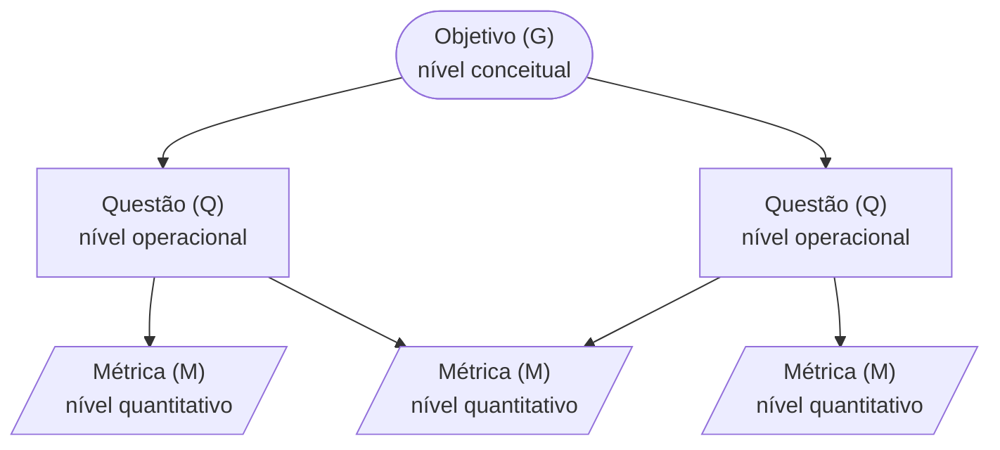

# Referencial Teórico

Esta seção apresenta os conceitos em que o trabalho se apoia: a definição de qualidade de
produto da série SQuaRE, o modelo de qualidade usado na avaliação, o processo de avaliação de
produto, a abordagem GQM, que especifica o que medir, e o PSM, que acompanha a gestão do
próprio projeto.

## Qualidade de software

A ISO/IEC 25010:2011 define a qualidade de um sistema como o grau em que ele satisfaz as
necessidades, explícitas e implícitas, das partes interessadas e, assim, agrega valor a elas
(ISO/IEC, 2011a). A definição tem duas consequências para uma avaliação:

- a qualidade só é avaliável em relação a **quem** usa o produto e **em que contexto**. Por isso,
  a [Fase 1](../fase-1/index.md) começa pelo propósito da avaliação e pelos stakeholders, e não
  pelas métricas;
- a qualidade não é medida diretamente: ela é decomposta em características e
  subcaracterísticas, que por sua vez são medidas.

A norma pertence à série **SQuaRE** (*Systems and software Quality Requirements and
Evaluation*), que organiza as normas de qualidade de produto em cinco divisões:

| Divisão | Assunto | Uso neste trabalho |
|---|---|---|
| ISO/IEC 2500n | Gestão da qualidade | — |
| ISO/IEC 2501n | Modelo de qualidade | ISO/IEC 25010: características e subcaracterísticas avaliadas |
| ISO/IEC 2502n | Medição da qualidade | ISO/IEC 25023: medidas usadas como base das métricas do GQM |
| ISO/IEC 2503n | Requisitos de qualidade | — |
| ISO/IEC 2504n | Avaliação da qualidade | Processo de avaliação de produto seguido nas quatro fases |

*Tabela 1: Divisões da série SQuaRE e seu uso no trabalho.*

## Modelo de qualidade

A ISO/IEC 25010:2011 tem dois modelos. O modelo de **qualidade em uso** descreve o resultado da
interação do usuário com o produto em um contexto real (efetividade, eficiência, satisfação,
ausência de risco e cobertura de contexto). O modelo de **qualidade de produto** descreve
propriedades do próprio software, em oito características e 31 subcaracterísticas
(ISO/IEC, 2011a):

| Característica | Pergunta a que responde |
|---|---|
| Adequação funcional | O produto oferece as funções necessárias, de forma correta? |
| Eficiência de desempenho | Qual o desempenho em relação aos recursos usados? |
| Compatibilidade | O produto troca informações e convive com outros produtos? |
| Usabilidade | Os usuários conseguem usar o produto com efetividade, eficiência e satisfação? |
| Confiabilidade | O produto funciona como especificado ao longo do tempo? |
| Segurança | O produto protege informações e dados? |
| Manutenibilidade | O produto pode ser modificado com eficácia e eficiência? |
| Portabilidade | O produto pode ser transferido para outros ambientes de hardware e software? |

*Tabela 2: Características do modelo de qualidade de produto da ISO/IEC 25010:2011.*

Este trabalho usa o modelo de qualidade de produto, porque a avaliação é externa (caixa-preta)
e as medições são feitas no portal, sem acesso a código ou a dados de uso. O modelo foi
adaptado ao produto, como recomendado no processo de avaliação (RAMOS, 2026c): das oito
características, foram mantidas usabilidade, eficiência de desempenho e portabilidade, pelos
critérios descritos na [Fase 1](../fase-1/index.md#13-enfase-por-caracteristica).

As medidas de cada subcaracterística seguem a ISO/IEC 25023, que pertence à divisão de medição
da SQuaRE e define, para cada subcaracterística, medidas com nome, função de medição e
interpretação (ISO/IEC, 2011b). Quando a medida da norma não pode ser aplicada diretamente a
um portal web, a ficha da métrica na [Fase 2](../fase-2/metricas.md) registra como ela foi
adaptada.

## Processo de avaliação de produto

A série SQuaRE organiza a avaliação de produto em um processo de quatro fases, adotado como
estrutura deste trabalho (RAMOS, 2026c):

*Figura 1: Fases do processo de avaliação de produto. Fonte: adaptado de Ramos (2026c).*

| Fase | Resultado principal | Neste trabalho |
|---|---|---|
| 1. Estabelecer os requisitos | Propósito, stakeholders, tipo de produto e modelo de qualidade | [Fase 1](../fase-1/index.md) |
| 2. Especificar a avaliação | Métricas, níveis de pontuação e critérios de julgamento | [Fase 2 (GQM)](../fase-2/index.md) |
| 3. Projetar a avaliação | Plano de avaliação: métodos, recursos, ambiente e cronograma | Entrega 2 |
| 4. Executar a avaliação | Medições, julgamento dos resultados e ações de melhoria | Entrega 2 |

*Tabela 3: Fases do processo de avaliação e onde cada uma é tratada no trabalho.*

## Abordagem GQM

A abordagem *Goal–Question–Metric* (GQM) parte do princípio de que a medição deve ser
orientada a objetivos: primeiro se define o que se quer saber e, só então, o que medir
(BASILI; CALDIERA; ROMBACH, 1994). O modelo resultante tem três níveis:

*Figura 2: Níveis da abordagem GQM. Uma métrica pode responder a mais de uma questão. Fonte:
adaptado de Basili, Caldiera e Rombach (1994).*

- **Nível conceitual (objetivo):** define o objeto medido, o propósito, o foco de qualidade, o
  ponto de vista e o contexto. Esses cinco elementos formam o *template* do objetivo
  (BASILI; CALDIERA; ROMBACH, 1994; RAMOS, 2026a):

    | Elemento | Pergunta |
    |---|---|
    | Analisar | Qual objeto é medido? |
    | Com o propósito de | Para quê? (caracterizar, entender, avaliar, prever, melhorar) |
    | Com respeito a | Qual foco de qualidade? |
    | Do ponto de vista de | Quem usa o resultado? |
    | No contexto de | Em qual ambiente? |

    *Tabela 4: Template do objetivo de medição no GQM.*

- **Nível operacional (questões):** refina o objetivo em perguntas que, quando respondidas,
  permitem concluir sobre ele. Para cada questão, registra-se uma **hipótese**, a resposta
  esperada antes da medição, que apoia a interpretação dos resultados (RAMOS, 2026a).
- **Nível quantitativo (métricas):** associa a cada questão os dados que a respondem, de forma
  objetiva.

O *abstraction sheet* resume um objetivo em quatro quadros (foco de qualidade, fatores de
variação, hipóteses de baseline e impacto dos fatores nas hipóteses) e explicita o que a
equipe já sabe ou espera do objeto antes de medir (RAMOS, 2026a).

Neste trabalho, o GQM é usado na Fase 2 do processo de avaliação: cada característica
selecionada na Fase 1 gera um objetivo de medição (G1 Usabilidade, G2 Portabilidade, G3
Eficiência de desempenho), detalhado nas páginas da [Fase 2](../fase-2/index.md).

## Medição para a gestão do projeto: PSM

Enquanto o GQM especifica a medição do **produto avaliado**, o acompanhamento do **projeto da
equipe** segue o PSM (*Practical Software and Systems Measurement*). O PSM é uma abordagem
dirigida por necessidades de informação: as medidas são escolhidas para apoiar decisões de
gestão (McGARRY et al., 2002; RAMOS, 2026b).

O PSM organiza as medidas em um modelo de informação, também adotado pela ISO/IEC/IEEE 15939,
que vai dos atributos medidos até um indicador interpretado à luz de critérios de decisão
(ISO/IEC/IEEE, 2017). O *Continuous Iterative Development (CID) Measurement Framework* adapta o
PSM a desenvolvimentos contínuos e iterativos e oferece um catálogo de categorias de
informação, conceitos mensuráveis e medidas (PSM, 2021a; PSM, 2021b). As medidas adotadas
pela equipe estão no [Plano de Medição](../gestao/plano-medicao.md).

---

## Referências

BASILI, V. R.; CALDIERA, G.; ROMBACH, H. D. The goal question metric approach. In: MARCINIAK, J. J. (ed.). **Encyclopedia of software engineering**. New York: Wiley, 1994. p. 528-532.

INTERNATIONAL ORGANIZATION FOR STANDARDIZATION; INTERNATIONAL ELECTROTECHNICAL COMMISSION. **ISO/IEC 25010:2011**: systems and software engineering — systems and software quality requirements and evaluation (SQuaRE) — system and software quality models. Genebra: ISO, 2011a.

INTERNATIONAL ORGANIZATION FOR STANDARDIZATION; INTERNATIONAL ELECTROTECHNICAL COMMISSION. **ISO/IEC WD 25023**: systems and software engineering — systems and software quality requirements and evaluation (SQuaRE) — measurement of system and software product quality. Working Draft, version 0.1.0. Genebra: ISO, 2011b.

INTERNATIONAL ORGANIZATION FOR STANDARDIZATION; INTERNATIONAL ELECTROTECHNICAL COMMISSION; INSTITUTE OF ELECTRICAL AND ELECTRONICS ENGINEERS. **ISO/IEC/IEEE 15939:2017**: systems and software engineering — measurement process. Genebra: ISO, 2017.

McGARRY, J. et al. **Practical software measurement**: objective information for decision makers. Boston: Addison-Wesley, 2002.

PRACTICAL SOFTWARE AND SYSTEMS MEASUREMENT. **Continuous Iterative Development Measurement Framework**: part 1: concepts, definitions, principles, and measures. Version 2.1. [S.l.]: PSM, 15 abr. 2021a. Disponível em: <http://www.psmsc.com/CIDMeasurement.asp>. Acesso em: 20 out. 2026.

PRACTICAL SOFTWARE AND SYSTEMS MEASUREMENT. **Continuous Iterative Development Measurement Framework**: part 2: measurement specifications and enterprise measures. Version 2.1. [S.l.]: PSM, 15 abr. 2021b. Disponível em: <http://www.psmsc.com/CIDMeasurement.asp>. Acesso em: 20 out. 2026.

RAMOS, C. S. **Medição baseada em objetivos**: determinando o que medir. Notas de aula da disciplina Qualidade de Software 1. Brasília: FCTE/UnB, 2026a.

RAMOS, C. S. **Medição prática de software e sistemas**: PSM. Notas de aula da disciplina Qualidade de Software 1. Brasília: FCTE/UnB, 2026b.

RAMOS, C. S. **Processo de avaliação de produto de software**. Notas de aula da disciplina Qualidade de Software 1. Brasília: FCTE/UnB, 2026c.
