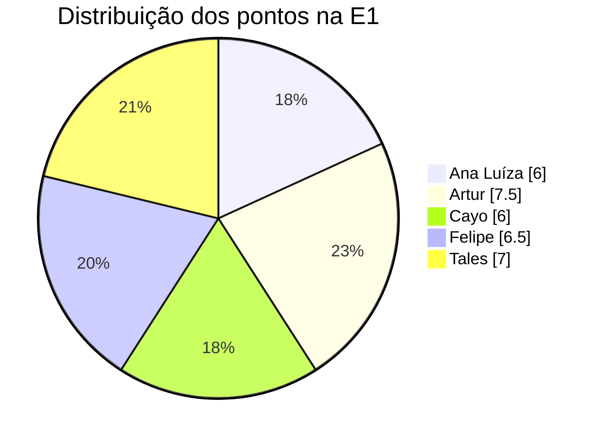

# Contribuição da Equipe

Tabela de contribuição da Entrega 1 (critério AG-C5). O percentual de participação de cada integrante foi calculado a partir das issues do [quadro do projeto](https://github.com/orgs/FCTE-Qualidade-de-Software-1/projects/7).

## Critério de cálculo

- Cada issue concluída vale **1 ponto** para o responsável; issues com dois responsáveis dividem o ponto (**0,5** para cada).
- Não entram na conta: issues abertas, issues-guarda-chuva da rubrica fechadas como não planejadas e a abertura de issues.
- Os PRs aparecem como evidência das tarefas e não somam pontos.
- Total da E1: **33 pontos**. Participação = pontos do integrante ÷ 33.

## Tabela de contribuição

| Integrante | Contribuições (issues e PRs) | Pontos | Participação |
|---|---|:---:|:---:|
| Ana Luíza | [#16](https://github.com/FCTE-Qualidade-de-Software-1/2026-2_T02_DOROTHY_JOHSON/issues/16) Configuração do kanban, das labels e das milestones do repositório [#18](https://github.com/FCTE-Qualidade-de-Software-1/2026-2_T02_DOROTHY_JOHSON/issues/18) Template de ata e registro das reuniões [#37](https://github.com/FCTE-Qualidade-de-Software-1/2026-2_T02_DOROTHY_JOHSON/issues/37) Seleção e priorização das características (método de priorização, trade-offs e ligação com stakeholders e propósito na Fase 1) ([PR #55](https://github.com/FCTE-Qualidade-de-Software-1/2026-2_T02_DOROTHY_JOHSON/pull/55)) [#5](https://github.com/FCTE-Qualidade-de-Software-1/2026-2_T02_DOROTHY_JOHSON/issues/5) Níveis de pontuação e critérios de julgamento ([PR #56](https://github.com/FCTE-Qualidade-de-Software-1/2026-2_T02_DOROTHY_JOHSON/pull/56)) [#34](https://github.com/FCTE-Qualidade-de-Software-1/2026-2_T02_DOROTHY_JOHSON/issues/34) Revisão final da E1 (revisão do artigo e da GitPage antes da release, critérios F2-C7, C8 e C12) [#15](https://github.com/FCTE-Qualidade-de-Software-1/2026-2_T02_DOROTHY_JOHSON/issues/15) Release da Entrega 1 | 6 | **18,2%** |
| Artur | [#21](https://github.com/FCTE-Qualidade-de-Software-1/2026-2_T02_DOROTHY_JOHSON/issues/21) Propósito da avaliação (decisões apoiadas pela avaliação, requisitante e stakeholders) ([PR #36](https://github.com/FCTE-Qualidade-de-Software-1/2026-2_T02_DOROTHY_JOHSON/pull/36)) [#22](https://github.com/FCTE-Qualidade-de-Software-1/2026-2_T02_DOROTHY_JOHSON/issues/22) Tipo de produto (descrição estruturada do software, diagramas e implicações para a avaliação) ([PR #36](https://github.com/FCTE-Qualidade-de-Software-1/2026-2_T02_DOROTHY_JOHSON/pull/36)) [#25](https://github.com/FCTE-Qualidade-de-Software-1/2026-2_T02_DOROTHY_JOHSON/issues/25) GQM de flexibilidade, com o Cayo (objetivo, questões, hipóteses e métricas) [#29](https://github.com/FCTE-Qualidade-de-Software-1/2026-2_T02_DOROTHY_JOHSON/issues/29) Introdução do artigo [#32](https://github.com/FCTE-Qualidade-de-Software-1/2026-2_T02_DOROTHY_JOHSON/issues/32) Seções de Fase 1 e Fase 2 do artigo [#35](https://github.com/FCTE-Qualidade-de-Software-1/2026-2_T02_DOROTHY_JOHSON/issues/35) Páginas da Fase 1 e da Fase 2 na GitPage [#48](https://github.com/FCTE-Qualidade-de-Software-1/2026-2_T02_DOROTHY_JOHSON/issues/48) Termos e subcaracterísticas atualizados para a ISO/IEC 25010:2023 na GitPage ([PR #51](https://github.com/FCTE-Qualidade-de-Software-1/2026-2_T02_DOROTHY_JOHSON/pull/51)) [#50](https://github.com/FCTE-Qualidade-de-Software-1/2026-2_T02_DOROTHY_JOHSON/issues/50) Correção das tabelas de objetivo de medição na GitPage Abertura e detalhamento das issues da E1 com os critérios da rubrica (#16 a #35) | 7,5 | **22,7%** |
| Cayo | [#24](https://github.com/FCTE-Qualidade-de-Software-1/2026-2_T02_DOROTHY_JOHSON/issues/24) GQM de capacidade de interação (objetivo, questões, hipóteses e métricas) ([PR #44](https://github.com/FCTE-Qualidade-de-Software-1/2026-2_T02_DOROTHY_JOHSON/pull/44)) [#25](https://github.com/FCTE-Qualidade-de-Software-1/2026-2_T02_DOROTHY_JOHSON/issues/25) GQM de flexibilidade, com o Artur ([PR #44](https://github.com/FCTE-Qualidade-de-Software-1/2026-2_T02_DOROTHY_JOHSON/pull/44)) [#30](https://github.com/FCTE-Qualidade-de-Software-1/2026-2_T02_DOROTHY_JOHSON/issues/30) Referencial teórico do artigo [#27](https://github.com/FCTE-Qualidade-de-Software-1/2026-2_T02_DOROTHY_JOHSON/issues/27) Fichas das métricas [#20](https://github.com/FCTE-Qualidade-de-Software-1/2026-2_T02_DOROTHY_JOHSON/issues/20) Registro semanal das medições PSM ([PR #57](https://github.com/FCTE-Qualidade-de-Software-1/2026-2_T02_DOROTHY_JOHSON/pull/57)) [#31](https://github.com/FCTE-Qualidade-de-Software-1/2026-2_T02_DOROTHY_JOHSON/issues/31) Metodologia do projeto ([PR #57](https://github.com/FCTE-Qualidade-de-Software-1/2026-2_T02_DOROTHY_JOHSON/pull/57)) [#11](https://github.com/FCTE-Qualidade-de-Software-1/2026-2_T02_DOROTHY_JOHSON/issues/11) Rastreabilidade entre Fase 1 e Fase 2, com o Felipe ([PR #57](https://github.com/FCTE-Qualidade-de-Software-1/2026-2_T02_DOROTHY_JOHSON/pull/57)) | 6 | **18,2%** |
| Felipe | [#19](https://github.com/FCTE-Qualidade-de-Software-1/2026-2_T02_DOROTHY_JOHSON/issues/19) Plano de medição PSM/CID (página do plano, script de coleta e workflow diário) ([PR #39](https://github.com/FCTE-Qualidade-de-Software-1/2026-2_T02_DOROTHY_JOHSON/pull/39)) [#23](https://github.com/FCTE-Qualidade-de-Software-1/2026-2_T02_DOROTHY_JOHSON/issues/23) Modelo de qualidade (subcaracterísticas validadas no portal, diagrama do modelo adaptado, justificativas e escopo) ([PR #40](https://github.com/FCTE-Qualidade-de-Software-1/2026-2_T02_DOROTHY_JOHSON/pull/40)) [#26](https://github.com/FCTE-Qualidade-de-Software-1/2026-2_T02_DOROTHY_JOHSON/issues/26) GQM de eficiência de desempenho (objetivo, abstraction sheet, questões, hipóteses, fichas e medição piloto) ([PR #41](https://github.com/FCTE-Qualidade-de-Software-1/2026-2_T02_DOROTHY_JOHSON/pull/41)) [#38](https://github.com/FCTE-Qualidade-de-Software-1/2026-2_T02_DOROTHY_JOHSON/issues/38) ODS, metas e indicadores (fontes do Ipea e do IBGE, metas 9.c e 16.10) ([PR #43](https://github.com/FCTE-Qualidade-de-Software-1/2026-2_T02_DOROTHY_JOHSON/pull/43)) [#52](https://github.com/FCTE-Qualidade-de-Software-1/2026-2_T02_DOROTHY_JOHSON/issues/52) Páginas e tarefas avaliadas movidas para a Fase 1 ([PR #53](https://github.com/FCTE-Qualidade-de-Software-1/2026-2_T02_DOROTHY_JOHSON/pull/53)) [#6](https://github.com/FCTE-Qualidade-de-Software-1/2026-2_T02_DOROTHY_JOHSON/issues/6) Gráfico GQM (hierarquia dos três objetivos, com legenda e versão em texto; figura no artigo) ([PR #54](https://github.com/FCTE-Qualidade-de-Software-1/2026-2_T02_DOROTHY_JOHSON/pull/54)) [#11](https://github.com/FCTE-Qualidade-de-Software-1/2026-2_T02_DOROTHY_JOHSON/issues/11) Rastreabilidade entre Fase 1 e Fase 2, com o Cayo Correção da lista de referências ([PR #42](https://github.com/FCTE-Qualidade-de-Software-1/2026-2_T02_DOROTHY_JOHSON/pull/42)) | 6,5 | **19,7%** |
| Gabriel | Nenhuma tarefa concluída no período (#5, #9 e #20 foram reatribuídas) | 0 | **0%** |
| Tales | [#17](https://github.com/FCTE-Qualidade-de-Software-1/2026-2_T02_DOROTHY_JOHSON/issues/17) Organização da estrutura de pastas do repositório [#28](https://github.com/FCTE-Qualidade-de-Software-1/2026-2_T02_DOROTHY_JOHSON/issues/28) Modelo LaTeX e esqueleto das seções do artigo [#45](https://github.com/FCTE-Qualidade-de-Software-1/2026-2_T02_DOROTHY_JOHSON/issues/45) Conversão do artigo para o modelo da SBC [#46](https://github.com/FCTE-Qualidade-de-Software-1/2026-2_T02_DOROTHY_JOHSON/issues/46) Remoção da parte de PSM do artigo [#49](https://github.com/FCTE-Qualidade-de-Software-1/2026-2_T02_DOROTHY_JOHSON/issues/49) Termos e subcaracterísticas atualizados para a ISO/IEC 25010:2023 no artigo [#9](https://github.com/FCTE-Qualidade-de-Software-1/2026-2_T02_DOROTHY_JOHSON/issues/9) Declaração de uso de IA [#33](https://github.com/FCTE-Qualidade-de-Software-1/2026-2_T02_DOROTHY_JOHSON/issues/33) Tabela de contribuição Abertura das issues iniciais com os critérios da rubrica (#1 a #15) | 7 | **21,2%** |
| **Total** | | **33** | **100%** |

!!! note "Validação"
    Percentuais atualizados em 26/10/2026 com o estado das issues no quadro do projeto. A mesma tabela entra como apêndice do artigo e deve ser validada pela equipe antes da entrega.
