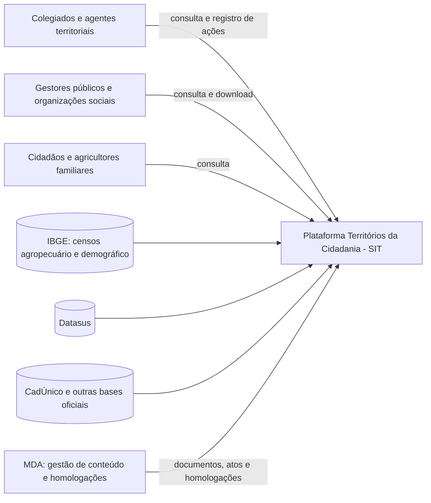

# Fase 1 — Estabelecer os requisitos de avaliação

A Fase 1 do processo de avaliação de produto da série SQuaRE define **por que** o produto
será avaliado, **o que** é o produto e **com qual modelo de qualidade** ele será analisado.
As decisões registradas aqui orientam diretamente a [Fase 2 (GQM)](../fase-2/index.md).

| Item | Valor |
|---|---|
| Produto | Plataforma Territórios da Cidadania — Sistema de Informações Territoriais (SIT) |
| Endereço | <https://territoriosdacidadania.mda.gov.br> |
| Responsável pelo produto | Ministério do Desenvolvimento Agrário e Agricultura Familiar (MDA) |
| Versão avaliada | Versão em produção na data de acesso (o portal não exibe número de versão) |
| Primeiro acesso para esta avaliação | 19/10/2026 |
| Modelo de qualidade | ISO/IEC 25010:2011 (modelo de qualidade de produto) |
| Tipo de avaliação | Externa (caixa-preta), restrita à área pública do portal |

---

## 1. Propósito da avaliação

### 1.1 Contexto

A Plataforma Territórios da Cidadania foi instituída como instrumento do Programa Nacional
de Desenvolvimento Territorial Sustentável ([BRASIL, 2025](../referencias.md)) e recupera o
SIT, desativado em 2016. Seu papel é reunir, em um único lugar, dados socioeconômicos e
ambientais dos territórios rurais (população, estabelecimentos agropecuários, Cadastro da
Agricultura Familiar, acesso a políticas públicas), além de mapas, atos normativos e o
registro das atividades dos Colegiados Territoriais.

Por ser um sistema **relançado recentemente** e voltado a um público heterogêneo, que inclui
agentes territoriais e agricultores familiares em áreas rurais, este é o momento em que uma
avaliação de qualidade tem maior potencial de influenciar a evolução do produto.

### 1.2 Requisitante e objetivo

| Elemento | Definição |
|---|---|
| Requisitante (simulado) | MDA, como órgão gestor da política territorial e responsável pela evolução do SIT |
| Avaliadores | Equipe Dorothy Johnson (avaliação independente, sem vínculo com o desenvolvimento) |
| Objetivo da avaliação | **Indicar pontos de melhoria no produto** (categoria do processo de avaliação vista em aula) |
| Uso pretendido dos resultados | Apoiar o requisitante na **priorização do backlog de evolução** do portal |

A avaliação deve responder a uma pergunta de gestão: **quais problemas de qualidade mais
dificultam o acesso do público-alvo às informações territoriais e, portanto, devem ser
tratados primeiro?** Os resultados apoiarão três decisões concretas do requisitante:

1. **Interface e fluxos de navegação** — quais telas e tarefas precisam ser redesenhadas
   para usuários com pouca familiaridade digital (usabilidade).
2. **Desempenho em condições reais de acesso** — se é necessário otimizar o carregamento
   das páginas e dos mapas para conexões móveis e aparelhos modestos (eficiência de desempenho).
3. **Cobertura de ambientes** — quais combinações de navegador, sistema operacional e
   tamanho de tela devem entrar na matriz de testes do fornecedor (portabilidade).

### 1.3 Ênfase por característica

A ênfase segue a escala do processo de avaliação (1 = nenhum interesse; 5 = grande interesse)
e considera o propósito acima, os stakeholders (Seção 2) e a viabilidade de medição em uma
avaliação caixa-preta.

| Característica (ISO/IEC 25010:2011) | Ênfase | Justificativa |
|---|:---:|---|
| Usabilidade | **5** | Público com níveis muito diferentes de letramento digital; o valor do SIT depende de o usuário encontrar e interpretar os dados sozinho. |
| Eficiência de desempenho | **4** | Uso em áreas rurais, com conexões móveis limitadas; o portal carrega mapas interativos e renderiza o conteúdo no navegador. |
| Portabilidade | **4** | Acesso predominante por celular (no Brasil, o Chrome para Android responde por cerca de 39% das versões de navegador em uso) e diversidade de navegadores e telas. |
| Adequação funcional | 3 | Relevante, mas não há especificação de requisitos pública que sirva de referência para medir completude e correção. |
| Confiabilidade | 2 | Medir disponibilidade exigiria monitoramento contínuo por um período maior que o da disciplina. |
| Segurança | 2 | A área restrita (Espaço do Colegiado) exige credenciais que a equipe não possui. |
| Compatibilidade | 2 | Interoperabilidade com outros sistemas do governo não é observável externamente. |
| Manutenibilidade | 1 | Sem acesso ao código-fonte nem à documentação técnica. |

Foram selecionadas as características com ênfase **4 ou 5**: usabilidade, eficiência de
desempenho e portabilidade. As demais ficam fora do escopo pelos motivos indicados.

!!! note "Compatibilidade × portabilidade"
    O funcionamento do portal em diferentes navegadores e dispositivos é tratado como
    **adaptabilidade** (subcaracterística de portabilidade), e não como compatibilidade.
    Na ISO/IEC 25010:2011, compatibilidade trata de coexistência e interoperabilidade
    com outros produtos, o que não é observável nesta avaliação.

---

## 2. Stakeholders

| Stakeholder | Papel | Necessidade principal | Critério de sucesso | Característica que motiva |
|---|---|---|---|---|
| MDA (área gestora da política territorial) | Requisitante | Saber onde investir na evolução do SIT | Lista priorizada de melhorias apoiada em evidências | Todas |
| Equipe de desenvolvimento e TI do SIT | Fornecedor | Saber o que corrigir e em quais ambientes testar | Defeitos reproduzíveis, com ambiente e passos | Portabilidade, eficiência |
| Colegiados e agentes territoriais | Usuários frequentes | Consultar dados do território para planejar e prestar contas | Encontrar a informação rapidamente, inclusive no celular | Usabilidade, portabilidade |
| Gestores públicos e organizações sociais | Usuários eventuais | Subsidiar projetos e políticas com dados territoriais | Dados acessíveis e baixáveis | Usabilidade, eficiência |
| Agricultores familiares e cidadãos | Público final | Conhecer as políticas que chegam ao seu território | Uso sem ajuda, em aparelho e conexão modestos | Usabilidade, eficiência, portabilidade |
| Equipe Dorothy Johnson | Avaliadora | Executar uma avaliação repetível | Métricas objetivas e coleta reprodutível | — |

---

## 3. Tipo de produto

### 3.1 Descrição geral

O SIT é uma **aplicação web pública** do governo federal. A navegação principal oferece
**nove seções**, levantadas no menu do portal em 19/10/2026:

| Seção | Função principal | Acesso |
|---|---|---|
| Início | Apresentação da plataforma e mapa da área de abrangência (Territórios da Cidadania, PDHC, PAS Nordeste) | Público |
| Meu Território | Consulta de indicadores consolidados de um território | Público |
| SITGeo | Plataforma geoespacial com cerca de 30 variáveis em 5 temas, exibidas como camadas de mapa | Público |
| Biblioteca Territorial | Download de documentos, mapas e atos normativos | Público |
| Homologações de Territórios | Consulta às homologações e modelos de documentos | Público |
| Território em Foco | Informativo institucional | Público |
| Fale Conosco | Canal de contato | Público |
| Sobre | Informações sobre a plataforma e a política | Público |
| Espaço do Colegiado | Registro das ações dos Colegiados Territoriais | **Restrito** (e-mail e senha; conta solicitada a um administrador) |

<!-- TODO (equipe): completar a contagem de funções e de janelas de interação
     dentro de cada seção (filtros, camadas, formulários) durante a exploração. -->

### 3.2 Classificação

| Taxonomia | Classificação | Justificativa |
|---|---|---|
| Pressman | **Aplicação web (WebApp) de sistema de informação** | Organiza e apresenta dados de bases oficiais (IBGE, Datasus, CadÚnico etc.) para consulta e apoio à decisão. Não se encaixa em "software comercial", pois não é comercializado. |
| IEEE 1062 | **Customizado (*Fully Developed*)** | Desenvolvido especificamente para o MDA e para a política territorial; não é um produto de prateleira (COTS) nem uma adaptação de um produto-padrão (MOTS). Classificação inferida, pois a avaliação é caixa-preta. |
| Domínio | Governo digital / desenvolvimento rural | Política pública de desenvolvimento territorial sustentável |

### 3.3 Usuários, ambiente e conhecimento exigido

- **Principais usuários:** colegiados e agentes territoriais, gestores públicos, organizações
  sociais, pesquisadores e cidadãos (com destaque para agricultores familiares).
- **Conhecimento de informática exigido:** básico (navegar na web, usar menus, filtros e mapas).
  O SITGeo exige um pouco mais: ativar camadas e interpretar legendas.
- **Conhecimento do domínio exigido:** baixo para consultas gerais; médio para interpretar
  indicadores e documentos da política territorial.
- **Ambiente de uso:** navegador web em computador ou celular, muitas vezes em áreas rurais
  com conexão móvel instável.

### 3.4 Requisitos de hardware e software

Até a data de acesso, a equipe não encontrou requisitos mínimos documentados no portal.
Pelas observações feitas, o acesso exige:

- navegador atualizado com **JavaScript habilitado**: sem execução de scripts, páginas como
  Meu Território e Biblioteca Territorial retornam praticamente vazias, o que indica
  renderização no lado do cliente;
- conexão com a internet;
- leitor de PDF para os documentos da Biblioteca Territorial (a confirmar na Fase 4).

### 3.5 Componentes avaliados e massa de dados

- **Avaliados:** todas as seções públicas listadas na Seção 3.1, com prioridade para Meu Território,
  SITGeo e Biblioteca Territorial, que concentram a finalidade do sistema.
- **Fora do escopo:** Espaço do Colegiado (área restrita, sem credenciais), servidores,
  APIs internas e código-fonte.
- **Massa de dados:** não é necessário criar dados de teste. O portal já disponibiliza dados
  reais de todos os territórios, e a avaliação usa um conjunto fixo de territórios de
  referência, definido na Fase 3, para garantir a repetibilidade.

### 3.6 Diagrama de contexto (inferido)

*Figura 1 — Diagrama de contexto do SIT, inferido a partir da área pública do portal e da
descrição oficial da plataforma.*

---

## 4. Modelo de qualidade

A avaliação usa o modelo de qualidade de produto da **ISO/IEC 25010:2011**. A nomenclatura
desta edição é mantida em todo o projeto (no artigo, nesta página e no GQM).

<!-- TODO (responsável pela issue "Especificar o modelo de qualidade"):
     validar as subcaracterísticas de usabilidade e eficiência abaixo. -->

| Característica | Subcaracterísticas consideradas | Fora do escopo (justificativa) |
|---|---|---|
| Usabilidade | Reconhecibilidade de adequação, apreensibilidade, operabilidade, proteção contra erros do usuário, estética da interface, acessibilidade | — |
| Eficiência de desempenho | Comportamento temporal, utilização de recursos | Capacidade (exigiria testes de carga no servidor) |
| Portabilidade | **Adaptabilidade** | Instalabilidade (aplicação web, sem instalação pelo usuário); substituibilidade (não há produto equivalente que o SIT substitua para o mesmo público) |

---

## 5. Escopo e limites da avaliação

- **Profundidade:** avaliação externa, com medições feitas a partir do navegador, de
  ferramentas públicas e de testes com usuários.
- **Objeto:** a versão em produção no período de coleta; como o portal não exibe versão,
  cada medição registra data e hora.
- **Limites de validade:** os resultados valem para a área pública e para os ambientes
  testados. Mudanças no portal durante a coleta serão registradas como ameaça à validade.

Próximo passo: [Fase 2 — Modelagem GQM](../fase-2/index.md).
