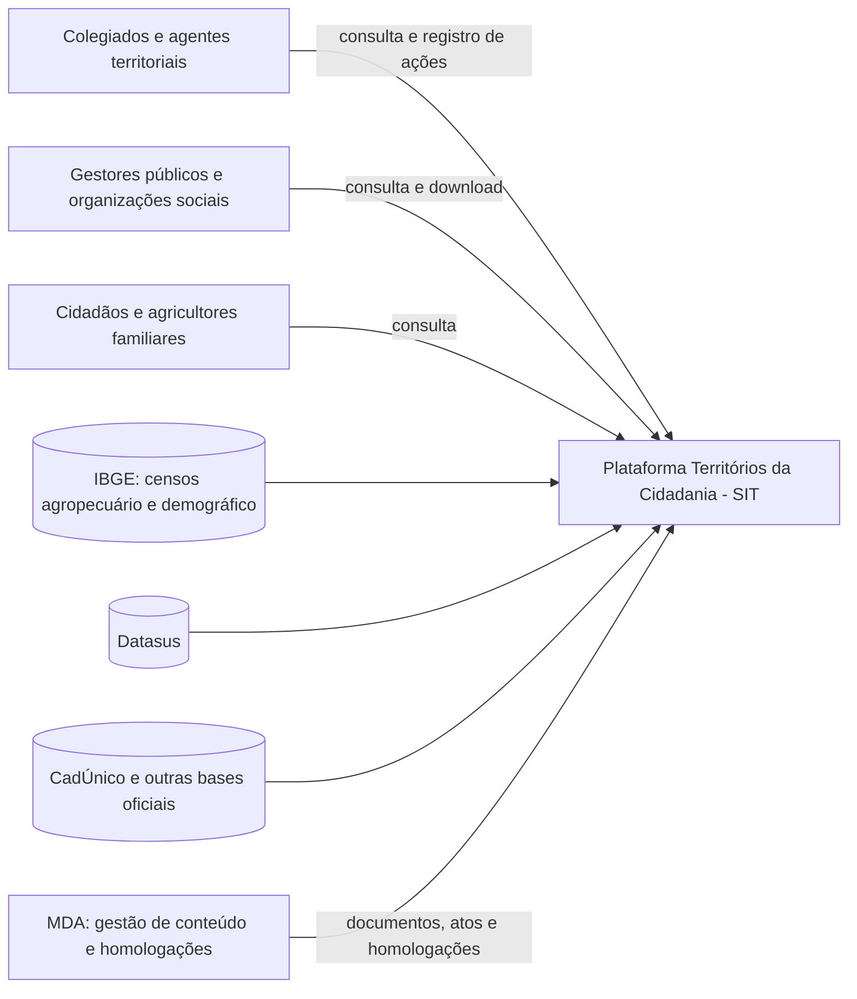
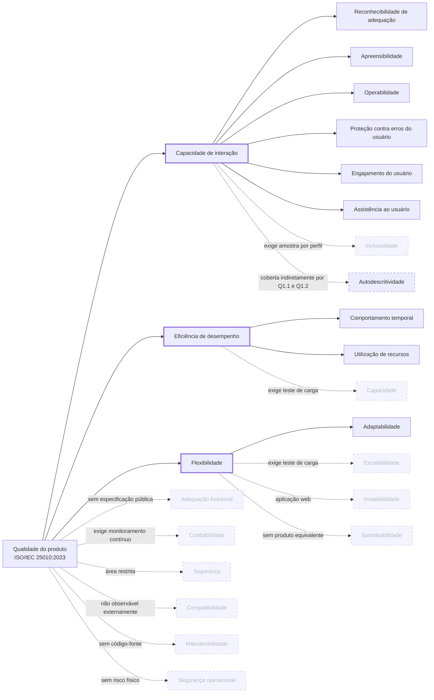

# Fase 1 — Estabelecer os requisitos de avaliação

A Fase 1 do processo de avaliação de produto da série SQuaRE define **por que** o produto
será avaliado, **o que** é o produto e **com qual modelo de qualidade** ele será analisado.
As decisões registradas aqui orientam diretamente a [Fase 2 (GQM)](../fase-2/index.md).

| Item | Valor |
|---|---|
| Produto | Plataforma Territórios da Cidadania — Sistema de Informações Territoriais (SIT) |
| Endereço | <https://territoriosdacidadania.mda.gov.br> |
| Responsável pelo produto | Ministério do Desenvolvimento Agrário e Agricultura Familiar (MDA) |
| Versão avaliada | Versão em produção na data de acesso (o portal não exibe número de versão) |
| Primeiro acesso para esta avaliação | 19/10/2026 |
| Modelo de qualidade | ISO/IEC 25010:2023, modelo de qualidade de produto (ISO/IEC, 2023) |
| Tipo de avaliação | Externa (caixa-preta), restrita à área pública do portal |

---

## 1. Propósito da avaliação

### 1.1 Contexto

A Plataforma Territórios da Cidadania foi instituída como instrumento do Programa Nacional
de Desenvolvimento Territorial Sustentável ([BRASIL, 2025](../referencias.md)) e recupera o
SIT, desativado em 2016. Seu papel é reunir, em um único lugar, dados socioeconômicos e
ambientais dos territórios rurais (população, estabelecimentos agropecuários, Cadastro da
Agricultura Familiar, acesso a políticas públicas), além de mapas, atos normativos e o
registro das atividades dos Colegiados Territoriais.

Por ser um sistema **relançado recentemente** e voltado a um público heterogêneo, que inclui
agentes territoriais e agricultores familiares em áreas rurais, este é o momento em que uma
avaliação de qualidade tem maior potencial de influenciar a evolução do produto.

### 1.2 Requisitante e objetivo

| Elemento | Definição |
|---|---|
| Requisitante (simulado) | MDA, como órgão gestor da política territorial e responsável pela evolução do SIT |
| Avaliadores | Equipe Dorothy Johnson (avaliação independente, sem vínculo com o desenvolvimento) |
| Objetivo da avaliação | **Indicar pontos de melhoria no produto** (categoria do processo de avaliação de produto, conforme Ramos, 2026c) |
| Uso pretendido dos resultados | Apoiar o requisitante na **priorização do backlog de evolução** do portal |

A avaliação deve responder a uma pergunta de gestão: **quais problemas de qualidade mais
dificultam o acesso do público-alvo às informações territoriais e, portanto, devem ser
tratados primeiro?** Os resultados apoiarão três decisões concretas do requisitante:

1. **Interface e fluxos de navegação** — quais telas e tarefas precisam ser redesenhadas
   para usuários com pouca familiaridade digital (capacidade de interação).
2. **Desempenho em condições reais de acesso** — se é necessário otimizar o carregamento
   das páginas e dos mapas para conexões móveis e aparelhos modestos (eficiência de desempenho).
3. **Cobertura de ambientes** — quais combinações de navegador, sistema operacional e
   tamanho de tela devem entrar na matriz de testes do fornecedor (flexibilidade).

### 1.3 Ênfase por característica e priorização {#13-enfase-por-caracteristica}

A seleção utiliza o **modelo de qualidade de produto da ISO/IEC 25010:2023** (família SQuaRE),
que compreende nove características (ISO/IEC, 2023). A escala de ênfase de 1 a 5 apresentada
no processo de avaliação de produto (RAMOS, 2026c) foi desdobrada em uma **matriz de decisão
multicritério ponderada**, para explicitar por que certas características têm prioridade.
O método reflete o propósito da Seção 1.2, as necessidades e os critérios de sucesso dos
stakeholders da Seção 2 e o caráter externo/caixa-preta da avaliação (Seções 3.5 e 5.1).

#### 1.3.1 Método de priorização

Cada característica recebe notas inteiras de **1 (menor) a 5 (maior)** em três critérios.
As notas são **julgamentos prévios de priorização**, baseados no contexto documentado, e
**não resultados de medições ou evidência de falhas** no SIT.

| Critério | Peso | O que representa | Âncoras para atribuir a nota |
|---|:---:|---|---|
| **I — Impacto no propósito e nos stakeholders** | **45%** | Quanto a característica contribui para uma das três decisões do MDA (Seção 1.2) e para os critérios de sucesso do público da Seção 2 | **1:** sem relação prática com as decisões; **3:** contribuição indireta ou a uma parte do público; **5:** contribuição direta para decisão prioritária e acesso do público-alvo |
| **R — Risco contextual de uma falha** | **30%** | Gravidade potencial da consequência de a característica não ser atendida no uso público do portal; **não** é a probabilidade medida de existir uma falha | **1:** consequência desprezível no contexto; **3:** prejuízo localizado; **5:** barreira grave ao acesso ou outro impacto importante |
| **V — Viabilidade da avaliação** | **25%** | Possibilidade de obter evidências repetíveis, éticas e válidas com acesso somente às páginas públicas e no prazo da disciplina | **1:** inviável de avaliar adequadamente; **3:** avaliação parcial viável; **5:** medição reproduzível viável no escopo |

A **pontuação ponderada** é calculada por:

**P = (0,45 × I) + (0,30 × R) + (0,25 × V)**

Aplica-se primeiro um **filtro de elegibilidade**: somente características com
**V ≥ 3** podem integrar o conjunto avaliado, pois não seria defensável prometer uma
avaliação sem evidências suficientes. Entre as elegíveis, selecionam-se as **três de maior
pontuação**, respeitando a orientação de avaliar de três a quatro características. Empates
seriam resolvidos por maior impacto (**I**) e, persistindo, por maior viabilidade (**V**).
O filtro não significa que uma característica inelegível seja pouco importante; sua exclusão
é uma **limitação de cobertura**, discutida abaixo e na Seção 5.1.

#### 1.3.2 Aplicação da matriz

| Característica — ISO/IEC 25010:2023 | I | R | V | P (1–5) | Decisão | Fundamentação contextual das notas |
|---|:---:|:---:|:---:|:---:|---|---|
| **Capacidade de interação** | 5 | 5 | 4 | **4,75** | **Selecionada — 1ª** | Encontrar dados sem ajuda é essencial para cidadãos e agentes territoriais (Seção 2) e orienta a decisão 1; testes com usuários e acessibilidade são possíveis, mas dependem de recrutamento. |
| **Eficiência de desempenho** | 5 | 4 | 5 | **4,70** | **Selecionada — 2ª** | Lentidão em conexão móvel pode dificultar consultas por agricultores familiares; atende à decisão 2 e permite medições instrumentadas e repetíveis no navegador. |
| **Flexibilidade** | 4 | 4 | 4 | **4,00** | **Selecionada — 3ª** | A adaptação a navegadores e telas atende à decisão 3 e à necessidade de uso em celulares; os testes são observáveis, mas exigem uma matriz viável de ambientes. |
| Adequação funcional | 4 | 3 | 2 | 3,20 | Não elegível | A correção dos dados seria relevante para gestores e usuários, porém não há requisitos públicos suficientes para julgar completude ou correção funcional de modo abrangente. |
| Segurança | 3 | 5 | 1 | 3,10 | Não elegível | Falhas de segurança poderiam ter consequências graves; a área restrita não é acessível e testes intrusivos no sistema público exigiriam autorização. **A nota de risco não afirma vulnerabilidade existente.** |
| Confiabilidade | 3 | 4 | 1 | 2,80 | Não elegível | Indisponibilidade prejudicaria o acesso, mas disponibilidade e recuperação exigem observação temporal incompatível com a coleta prevista. |
| Compatibilidade | 2 | 3 | 1 | 2,05 | Não elegível | Interoperabilidade com bases e sistemas de governo importa ao funcionamento institucional, porém não é verificável adequadamente pela interface pública. |
| Manutenibilidade | 2 | 2 | 1 | 1,75 | Não elegível | A facilidade de evolução interessa à equipe técnica, mas depende de código e informações internas indisponíveis. |
| Segurança operacional (*safety*) | 1 | 1 | 1 | 1,00 | Não elegível | Não há controle de processos ou equipamentos físicos; o atributo tem baixa pertinência ao propósito desta avaliação. |

A classificação resulta de **julgamento contextual explícito**, não de análise estatística:
a diferença entre 4,75 e 4,70, por exemplo, não demonstra superioridade objetiva de uma
característica. O resultado determina **prioridade de avaliação**, não um diagnóstico de
qualidade do produto nem a ordem definitiva de correção de defeitos. O MDA decidirá sobre o
*backlog* após examinar as evidências coletadas.

#### 1.3.3 Vínculo com as decisões, stakeholders e GQM

| Prioridade | Característica escolhida | Decisão da Seção 1.2 | Stakeholders e critérios de sucesso da Seção 2 | Desdobramento na Fase 2 |
|---|---|---|---|---|
| **1** | Capacidade de interação | **1. Interface e fluxos:** identificar tarefas e telas a redesenhar | Colegiados e agentes: encontrar informação rapidamente; agricultores e cidadãos: consultar sem ajuda; gestores: acessar dados | [G1 — Capacidade de interação](../fase-2/objetivos.md#g1-capacidade-de-interacao) |
| **2** | Eficiência de desempenho | **2. Desempenho:** decidir se é necessário otimizar páginas e mapas sob conexão móvel | Agricultores e cidadãos: usar aparelhos e conexões modestos; equipe de TI: obter problemas reproduzíveis | [G3 — Eficiência de desempenho](../fase-2/objetivos.md#g3-eficiencia-de-desempenho) |
| **3** | Flexibilidade | **3. Cobertura de ambientes:** definir navegadores, sistemas e telas a testar | Equipe de TI: reproduzir falhas por ambiente; colegiados e agentes: acessar pelo celular | [G2 — Flexibilidade](../fase-2/objetivos.md#g2-flexibilidade) |

A matriz não atribui pesos numéricos diferentes a grupos de pessoas: as notas de impacto
consideram conjuntamente as necessidades documentadas, sem supor representatividade
estatística ou entrevistas de validação que não foram realizadas.

#### 1.3.4 Trade-offs e riscos residuais

- **Cobertura do produto × evidência válida.** Avaliar também adequação funcional seria útil
  para verificar se informações e funções atendem às necessidades dos gestores; sem uma
  especificação pública de referência, a equipe poderia confundir comportamento observado
  com requisito esperado. A prioridade é garantir resultados verificáveis em três dimensões.
- **Importância da segurança × autorização.** O potencial impacto de problemas de segurança
  é elevado, mas isso não autoriza testes de invasão nem permite inferir a segurança de áreas
  autenticadas. A exclusão é uma **lacuna relevante** a ser comunicada ao MDA, com sugestão
  de avaliação própria por equipe autorizada, e não uma declaração de que o portal é seguro.
- **Acesso contínuo × prazo da avaliação.** Confiabilidade merece acompanhamento do gestor,
  mas uma janela curta não permite sustentar conclusões sobre disponibilidade e recuperação.
- **Amplitude técnica × caixa-preta.** Compatibilidade entre sistemas e manutenibilidade
  exigiriam acesso a integrações, código ou documentação interna. Segurança operacional é
  pouco pertinente à aplicação; nenhuma dessas exclusões constitui evidência de boa ou má qualidade.
- **Profundidade × número de características.** Incluir uma quarta característica reduziria
  o esforço disponível para testar tarefas, ambientes e perfis das três selecionadas; o
  benefício só superaria esse custo com acesso adicional a requisitos, sistemas ou métricas
  que tornasse uma quarta dimensão avaliável. A inclusão de usuários de perfis diversos
  também não substitui uma avaliação conclusiva de inclusividade (Seção 5.1).

!!! note "Limite e revisão da decisão"
A matriz é uma proposta justificada a partir do contexto registrado. As notas, os pesos
e os trade-offs devem ser conferidos por **outro integrante da equipe** antes de encerrar
a issue #37; essa revisão ainda não está documentada neste arquivo. Caso o escopo ou o
acesso ao sistema mude, a priorização deverá ser reavaliada.

!!! note "Compatibilidade × flexibilidade"
O funcionamento do portal em diferentes navegadores e dispositivos é tratado como
**adaptabilidade** (subcaracterística de flexibilidade), e não como compatibilidade.
Na ISO/IEC 25010:2023, compatibilidade trata de coexistência e interoperabilidade
com outros produtos, o que não é observável nesta avaliação.

### 1.4 Relação com os Objetivos de Desenvolvimento Sustentável (ODS)

A Portaria que instituiu o Programa Nacional de Desenvolvimento Territorial Sustentável não
cita a Agenda 2030, mas inclui o SIT entre os instrumentos de implementação do Programa
(art. 9º, VII) e tem como diretriz a ampliação do acesso a políticas públicas nos territórios
(art. 4º, I) ([BRASIL, 2025](../referencias.md)). Esse papel de canal de informação para
agentes territoriais e agricultores familiares em áreas rurais, que precisam usar o portal
inclusive no celular (Seção 2), liga o produto a duas metas dos ODS.

O texto das metas segue a adequação à realidade brasileira feita pelo Ipea; quando a meta foi
mantida sem alteração, vale o texto das Nações Unidas (IPEA, 2019a; IPEA, 2019b). O status
dos indicadores é o informado pelo IBGE no portal ODS Brasil (IBGE, 2026).

| ODS | Meta (versão Brasil) | Indicador (status no Brasil) | Papel do SIT | Característica avaliada que afeta a contribuição |
|---|---|---|---|---|
| 9: Indústria, inovação e infraestrutura | **9.c** Aumentar significativamente o acesso às tecnologias de informação e comunicação e empenhar-se para oferecer acesso universal e a preços acessíveis à internet, até 2020, **buscando garantir a qualidade**, a privacidade, a proteção de dados e a segurança cibernética | **9.c.1** Proporção da população coberta por rede móvel, por tipo de tecnologia (produzido) | Serviço digital do governo oferecido a quem está nas áreas cobertas por rede móvel, inclusive as rurais | **Eficiência de desempenho**: o portal precisa ser utilizável na conexão móvel que a cobertura oferece. **Flexibilidade**: o acesso é feito por celulares e navegadores variados |
| 16: Paz, justiça e instituições eficazes | **16.10** Assegurar o acesso público à informação e proteger as liberdades fundamentais, em conformidade com a legislação nacional e os acordos internacionais (meta mantida sem alteração) | **16.10.2** Número de países que adotam e implementam garantias constitucionais, estatutárias e/ou políticas para acesso público à informação (produzido) | Publica dados socioeconômicos, mapas e atos normativos dos territórios rurais | **Capacidade de interação**: a informação publicada só é acessada de fato se o usuário consegue encontrá-la e interpretá-la sem ajuda |

**Pertinência ao software avaliado.** Os dois indicadores medem condições do país, e não o
SIT: a cobertura de rede móvel (9.c.1) e a existência de garantias de acesso à informação
(16.10.2). O SIT não altera esses números, mas é um dos meios pelos quais essas condições se
convertem em acesso efetivo. A própria meta 9.c, na versão brasileira, associa o acesso às TIC
à sua qualidade, e a meta 16.10 fala em *implementar* o acesso à informação, não apenas em
garanti-lo em lei. Por isso a avaliação contribui para as duas metas no ponto em que o
software tem influência:

- uma pessoa coberta por rede móvel (9.c.1) só tem acesso efetivo ao SIT se as páginas
  carregam em tempo aceitável nessa conexão e funcionam no aparelho que ela usa, o que é
  verificado pelas métricas de eficiência de desempenho e de flexibilidade da Fase 2;
- um dado publicado pelo SIT só cumpre a meta 16.10 se o público consegue chegar até ele, o
  que é verificado pelas métricas de capacidade de interação.

!!! note "Prazo da meta 9.c"
A meta 9.c tinha 2020 como horizonte para o acesso universal à internet. O IBGE continua
produzindo o indicador 9.c.1, e a parte da meta ligada à qualidade do acesso segue
pertinente para o SIT.

---

## 2. Stakeholders

| Stakeholder | Papel | Necessidade principal | Critério de sucesso | Característica que motiva |
|---|---|---|---|---|
| MDA (área gestora da política territorial) | Requisitante | Saber onde investir na evolução do SIT | Lista priorizada de melhorias apoiada em evidências | Todas |
| Equipe de desenvolvimento e TI do SIT | Fornecedor | Saber o que corrigir e em quais ambientes testar | Defeitos reproduzíveis, com ambiente e passos | Flexibilidade, eficiência |
| Colegiados e agentes territoriais | Usuários frequentes | Consultar dados do território para planejar e prestar contas | Encontrar a informação rapidamente, inclusive no celular | Capacidade de interação, flexibilidade |
| Gestores públicos e organizações sociais | Usuários eventuais | Subsidiar projetos e políticas com dados territoriais | Dados acessíveis e baixáveis | Capacidade de interação, eficiência |
| Agricultores familiares e cidadãos | Público final | Conhecer as políticas que chegam ao seu território | Uso sem ajuda, em aparelho e conexão modestos | Capacidade de interação, eficiência, flexibilidade |
| Equipe Dorothy Johnson | Avaliadora | Executar uma avaliação repetível | Métricas objetivas e coleta reprodutível | — |

---

## 3. Tipo de produto

### 3.1 Descrição geral

O SIT é uma **aplicação web pública** do governo federal. A navegação principal oferece
**nove seções**, levantadas no menu do portal (BRASIL, 2026) em 19/10/2026:

| Seção | Função principal | Acesso |
|---|---|---|
| Início | Apresentação da plataforma e mapa da área de abrangência (Territórios da Cidadania, PDHC, PAS Nordeste) | Público |
| Meu Território | Consulta de indicadores consolidados de um território | Público |
| SITGeo | Plataforma geoespacial com cerca de 30 variáveis em 5 temas, exibidas como camadas de mapa | Público |
| Biblioteca Territorial | Download de documentos, mapas e atos normativos | Público |
| Homologações de Territórios | Consulta às homologações e modelos de documentos | Público |
| Território em Foco | Informativo institucional | Público |
| Fale Conosco | Canal de contato | Público |
| Sobre | Informações sobre a plataforma e a política | Público |
| Espaço do Colegiado | Registro das ações dos Colegiados Territoriais | **Restrito** (e-mail e senha; conta solicitada a um administrador) |

<!-- TODO (equipe): completar a contagem de funções e de janelas de interação
     dentro de cada seção (filtros, camadas, formulários) durante a exploração. -->

### 3.2 Classificação

| Taxonomia | Classificação | Justificativa |
|---|---|---|
| Pressman (2002) | **Aplicação web (WebApp) de sistema de informação** | Organiza e apresenta dados de bases oficiais (IBGE, Datasus, CadÚnico etc.) para consulta e apoio à decisão. Não se encaixa em "software comercial", pois não é comercializado. |
| IEEE 1062 (IEEE, 1998) | **Customizado (*Fully Developed*)** | Desenvolvido especificamente para o MDA e para a política territorial; não é um produto de prateleira (COTS) nem uma adaptação de um produto-padrão (MOTS). Classificação inferida, pois a avaliação é caixa-preta. |
| Domínio | Governo digital / desenvolvimento rural | Política pública de desenvolvimento territorial sustentável |

### 3.3 Usuários, ambiente e conhecimento exigido

- **Principais usuários:** colegiados e agentes territoriais, gestores públicos, organizações
  sociais, pesquisadores e cidadãos (com destaque para agricultores familiares).
- **Conhecimento de informática exigido:** básico (navegar na web, usar menus, filtros e mapas).
  O SITGeo exige um pouco mais: ativar camadas e interpretar legendas.
- **Conhecimento do domínio exigido:** baixo para consultas gerais; médio para interpretar
  indicadores e documentos da política territorial.
- **Ambiente de uso:** navegador web em computador ou celular. O público final e os agentes
  territoriais acessam, em geral, pelo próprio celular, em casa, na sede do colegiado ou no
  campo, em municípios do interior com sinal de rede móvel fraco ou instável; gestores e
  organizações sociais acessam também por computadores em escritórios de prefeituras,
  sindicatos e órgãos públicos.

### 3.4 Requisitos de hardware e software

Até a data de acesso, a equipe não encontrou requisitos mínimos documentados no portal.
Pelas observações feitas, o acesso exige:

- navegador atualizado com **JavaScript habilitado**: sem execução de scripts, páginas como
  Meu Território e Biblioteca Territorial retornam praticamente vazias, o que indica
  renderização no lado do cliente;
- conexão com a internet;
- leitor de PDF para os documentos da Biblioteca Territorial (a confirmar na Fase 4).

### 3.5 Componentes avaliados e massa de dados

- **Avaliados:** todas as seções públicas listadas na Seção 3.1, com prioridade para Meu Território,
  SITGeo e Biblioteca Territorial, que concentram a finalidade do sistema.
- **Fora do escopo:** Espaço do Colegiado (área restrita, sem credenciais), servidores,
  APIs internas e código-fonte.
- **Massa de dados:** não é necessário criar dados de teste. O portal já disponibiliza dados
  reais de todos os territórios, e a avaliação usa um conjunto fixo de territórios de
  referência, definido na Fase 3, para garantir a repetibilidade.

### 3.6 Páginas e tarefas avaliadas

Os objetivos de medição da Fase 2 analisam o SIT por meio das páginas e tarefas abaixo. Cada
característica usa as páginas em que suas subcaracterísticas são observáveis (Seção 4.2).

| Característica | Objetivo | Páginas | Tarefas |
|---|---|---|---|
| Capacidade de interação | G1 | Início, Meu Território, SITGeo, Biblioteca Territorial e Fale Conosco | T1, T2 e T3 |
| Flexibilidade | G2 | Meu Território, SITGeo e Biblioteca Territorial | T1, T2 e T3 |
| Eficiência de desempenho | G3 | Meu Território, SITGeo e Biblioteca Territorial | T1 e T2 |

Na capacidade de interação entram também a página Início, ponto de partida das tarefas, e o
Fale Conosco, onde a Seção 4.2 localiza a proteção contra erros do usuário.

- **T1, consultar um território:** em Meu Território, selecionar a UF e o território e acionar
  "Selecionar" até os dados do território serem exibidos.
- **T2, ativar uma camada no mapa:** no SITGeo, escolher um tema e ativar uma camada até ela
  ser exibida no mapa.
- **T3, baixar um documento do território:** na Biblioteca Territorial, selecionar a UF e o
  território e baixar o PTDRS.

Na capacidade de interação e na flexibilidade, cada tarefa começa na página Início, porque a
navegação até a seção faz parte do que é avaliado. Na eficiência de desempenho, a tarefa
começa já na página correspondente, porque a medida é o tempo entre a ação do usuário e a
exibição do resultado. O território, a camada e o documento de referência são fixados na
Fase 3 e são os mesmos para todas as características.

### 3.7 Diagrama de contexto (inferido)

*Figura 1 — Diagrama de contexto do SIT, inferido a partir da área pública do portal e da
descrição oficial da plataforma.*

---

## 4. Modelo de qualidade

A avaliação usa o modelo de qualidade de produto da **ISO/IEC 25010:2023** (ISO/IEC, 2023), edição
que substituiu a de 2011. A nomenclatura desta edição é mantida em todo o projeto (no artigo,
nas páginas e no GQM); a correspondência com os termos de 2011, ainda usados pela ISO/IEC 25023,
está na Seção 4.3.

Seguindo a orientação de adaptar o modelo de qualidade ao contexto do software e ao objetivo
do requisitante (RAMOS, 2026c), o modelo foi adaptado ao SIT a partir de dois filtros: a matriz multicritério e o filtro
de viabilidade (Seção 1.3), seguidos da possibilidade de medir cada subcaracterística de fora do sistema, apenas pela
área pública do portal (Seção 3.5). Cada subcaracterística mantida foi conferida no portal (BRASIL, 2026) em
20/10/2026, identificando onde ela pode ser observada.

### 4.1 Representação do modelo adaptado

*Figura 2: Modelo de qualidade adaptado ao SIT. Linhas contínuas e bordas grossas indicam as
características e subcaracterísticas avaliadas; linhas e bordas tracejadas indicam o que ficou
fora do escopo, com o motivo resumido na ligação (detalhado na Seção 5). A autodescritividade
aparece tracejada, mas sem esmaecer, porque é coberta indiretamente pelas questões Q1.1 e Q1.2.*

### 4.2 Subcaracterísticas avaliadas

A coluna **Decisão que apoia** remete às três decisões do requisitante (Seção 1.2) e a coluna
**Stakeholder** remete à Seção 2.

| Característica | Subcaracterística | Onde é observável no SIT | Decisão que apoia | Stakeholder |
|---|---|---|---|---|
| Capacidade de interação | Reconhecibilidade de adequação | Textos de abertura que explicam a finalidade de cada seção (ex.: Meu Território, SITGeo, Biblioteca Territorial) | 1. Interface e fluxos | Agricultores familiares e cidadãos; gestores públicos e organizações sociais |
| Capacidade de interação | Apreensibilidade | Fluxo de seleção UF → Território → Selecionar (Meu Território e Biblioteca Territorial); escolha de tema e ativação de camadas no SITGeo | 1. Interface e fluxos | Agricultores familiares e cidadãos; colegiados e agentes territoriais |
| Capacidade de interação | Operabilidade | Caixas de seleção, abas de programas (CAF, PRONAF, PAA etc.) e controles do mapa (zoom, camadas) | 1. Interface e fluxos | Colegiados e agentes territoriais |
| Capacidade de interação | Proteção contra erros do usuário | Formulário do Fale Conosco (nome, e-mail, telefone, assunto, mensagem) e botões desabilitados até a seleção estar completa (ex.: "Buscar PTDRS" na Biblioteca Territorial) | 1. Interface e fluxos | Agricultores familiares e cidadãos |
| Capacidade de interação | Engajamento do usuário | Todas as seções públicas (apresentação convidativa das informações e das funções) | 1. Interface e fluxos | Agricultores familiares e cidadãos |
| Capacidade de interação | Assistência ao usuário (uso por pessoas com deficiência) | Todas as seções públicas, com prioridade para Meu Território, SITGeo e Biblioteca Territorial | 1. Interface e fluxos | Agricultores familiares e cidadãos; MDA |
| Eficiência de desempenho | Comportamento temporal | Carregamento das páginas renderizadas no navegador (Seção 3.4) e das camadas do SITGeo | 2. Desempenho em condições reais | Agricultores familiares e cidadãos; equipe de desenvolvimento e TI |
| Eficiência de desempenho | Utilização de recursos | Processamento (CPU) e memória exigidos do aparelho pelo carregamento das páginas e pelas tarefas (mapas e scripts) | 2. Desempenho em condições reais | Agricultores familiares e cidadãos; equipe de desenvolvimento e TI |
| Flexibilidade | Adaptabilidade | Execução das mesmas tarefas em diferentes navegadores, sistemas operacionais e tamanhos de tela | 3. Cobertura de ambientes | Equipe de desenvolvimento e TI; colegiados e agentes territoriais |

### 4.3 Correspondência com a ISO/IEC 25010:2011

A ISO/IEC 25010:2023 renomeou duas das características selecionadas e reorganizou parte das
subcaracterísticas em relação à edição anterior (ISO/IEC, 2011a; ISO/IEC, 2023). Como as
medidas da ISO/IEC 25023 usadas na [Fase 2](../fase-2/metricas.md) ainda seguem os termos de
2011, a tabela abaixo registra a correspondência.

| ISO/IEC 25010:2011 | ISO/IEC 25010:2023 | Situação nesta avaliação |
|---|---|---|
| Usabilidade | **Capacidade de interação** | Selecionada (prioridade 1; P = 4,75) |
| Reconhecibilidade de adequação | Reconhecibilidade de adequação | Avaliada (Q1.1) |
| Apreensibilidade | Apreensibilidade | Avaliada (Q1.2) |
| Operabilidade | Operabilidade | Avaliada (Q1.3) |
| Proteção contra erros do usuário | Proteção contra erros do usuário | Avaliada (Q1.4) |
| Estética da interface do usuário | **Engajamento do usuário** (substitui) | Avaliada (Q1.5) |
| Acessibilidade | **Assistência ao usuário** e **inclusividade** (dividida) | Assistência ao usuário avaliada (Q1.6); inclusividade fora do escopo |
| — | **Autodescritividade** (nova) | Coberta por Q1.1 e Q1.2 |
| Portabilidade | **Flexibilidade** | Selecionada (prioridade 3; P = 4,00) |
| Adaptabilidade | Adaptabilidade | Avaliada (Q2.1 a Q2.3) |
| — | **Escalabilidade** (nova) | Fora do escopo |
| Instalabilidade | Instalabilidade | Fora do escopo |
| Substituibilidade | Substituibilidade | Fora do escopo |
| — | **Segurança operacional (*safety*)** (nova característica) | Não elegível (P = 1,00; Seção 1.3) |

---

## 5. Escopo e limites da avaliação

- **Profundidade:** avaliação externa, com medições feitas a partir do navegador, de
  ferramentas públicas e de testes com usuários.
- **Objeto:** a versão em produção no período de coleta; como o portal não exibe versão,
  cada medição registra data e hora.

### 5.1 O que ficou fora do escopo

| O que ficou fora | Motivo | Efeito na validade dos resultados |
|---|---|---|
| Adequação funcional | Não há especificação de requisitos pública que sirva de referência para medir completude e correção | Os resultados não indicam se as funções do SIT estão completas ou corretas |
| Confiabilidade | Medir disponibilidade e tolerância a falhas exigiria monitoramento contínuo por um período maior que o da disciplina | Nenhuma conclusão sobre disponibilidade ou recuperação de falhas |
| Segurança | A área restrita exige credenciais que a equipe não possui, e testes de segurança em um sistema de governo em produção dependeriam de autorização do responsável | Nenhuma conclusão sobre confidencialidade, integridade ou autenticação |
| Compatibilidade | A interoperabilidade com outros sistemas do governo não é observável externamente | Os resultados não cobrem a troca de dados com as bases de origem (IBGE, Datasus, CadÚnico) |
| Manutenibilidade | Sem acesso ao código-fonte nem à documentação técnica | Nenhuma conclusão sobre a facilidade de evolução do sistema |
| Capacidade (eficiência de desempenho) | Exigiria testes de carga no servidor de produção, com risco de afetar usuários reais | Os resultados de desempenho valem para acessos individuais, não para picos de uso |
| Inclusividade (capacidade de interação) | Avaliar o uso por pessoas de diferentes idades, escolaridades, regiões e condições econômicas exigiria uma amostra estratificada por perfil, maior que a viável na disciplina | Os perfis dos participantes são registrados, mas os resultados não permitem conclusões por grupo de usuários |
| Autodescritividade (capacidade de interação) | Nesta avaliação, se sobrepõe às medidas de reconhecibilidade de adequação e de apreensibilidade, que já usam as medidas de autodescrição da ISO/IEC 25023 (Q1.1 e Q1.2); uma questão separada mediria o mesmo atributo duas vezes | Coberta indiretamente pelas questões Q1.1 e Q1.2 |
| Escalabilidade (flexibilidade) | Exigiria variar a carga de trabalho no servidor de produção, com o mesmo risco da capacidade | Os resultados não indicam como o portal se comporta com aumento ou redução de demanda |
| Segurança operacional (*safety*) | O portal não controla equipamentos nem processos físicos | Não se aplica ao produto |
| Instalabilidade (flexibilidade) | Aplicação web, sem instalação pelo usuário | Não se aplica ao produto |
| Substituibilidade (flexibilidade) | Não há produto equivalente que o SIT substitua para o mesmo público | Não se aplica ao produto |
| Espaço do Colegiado | Área restrita, sem credenciais | Os resultados não valem para o registro de atividades dos colegiados |
| Servidores, APIs internas e código-fonte | Avaliação caixa-preta | Os resultados descrevem apenas o comportamento observável no navegador |
| Envio real de mensagens pelo Fale Conosco | A avaliação não deve gerar demandas reais ao MDA | A proteção contra erros é avaliada na validação do formulário antes do envio, sem cobrir o tratamento da mensagem |

### 5.2 Limites de validade

Os resultados valem para a área pública do portal e para os ambientes testados (navegadores,
sistemas operacionais e tamanhos de tela definidos na Fase 3). Mudanças no portal durante a
coleta serão registradas como ameaça à validade.

## Referências

BRASIL. Ministério do Desenvolvimento Agrário e Agricultura Familiar. Portaria MDA nº 35, de 15 de setembro de 2025. Institui o Programa Nacional de Desenvolvimento Territorial Sustentável. **Diário Oficial da União**: seção 1, Brasília, DF, ed. 176, p. 29, 16 set. 2025. Disponível em: <https://www.in.gov.br/en/web/dou/-/portaria-mda-n-35-de-15-de-setembro-de-2025-656044670>. Acesso em: 20 out. 2026.

BRASIL. Ministério do Desenvolvimento Agrário e Agricultura Familiar. **Plataforma Territórios da Cidadania**: Sistema de Informações Territoriais (SIT). Brasília: MDA, 2026. Disponível em: <https://territoriosdacidadania.mda.gov.br>. Acesso em: 20 out. 2026.

INSTITUTE OF ELECTRICAL AND ELECTRONICS ENGINEERS. **IEEE Std 1062-1998**: IEEE recommended practice for software acquisition. New York: IEEE, 1998.

INSTITUTO BRASILEIRO DE GEOGRAFIA E ESTATÍSTICA. **Indicadores dos Objetivos de Desenvolvimento Sustentável**: Brasil. Rio de Janeiro: IBGE, 2026. Disponível em: <https://odsbrasil.gov.br>. Acesso em: 20 out. 2026.

INSTITUTO DE PESQUISA ECONÔMICA APLICADA. **ODS 9**: indústria, inovação e infraestrutura. Brasília: Ipea, 2019a. Disponível em: <https://www.ipea.gov.br/ods/ods9.html>. Acesso em: 20 out. 2026.

INSTITUTO DE PESQUISA ECONÔMICA APLICADA. **ODS 16**: paz, justiça e instituições eficazes. Brasília: Ipea, 2019b. Disponível em: <https://www.ipea.gov.br/ods/ods16.html>. Acesso em: 20 out. 2026.

INTERNATIONAL ORGANIZATION FOR STANDARDIZATION; INTERNATIONAL ELECTROTECHNICAL COMMISSION. **ISO/IEC 25010:2011**: systems and software engineering — systems and software quality requirements and evaluation (SQuaRE) — system and software quality models. Genebra: ISO, 2011a.

INTERNATIONAL ORGANIZATION FOR STANDARDIZATION; INTERNATIONAL ELECTROTECHNICAL COMMISSION. **ISO/IEC 25010:2023**: systems and software engineering — systems and software quality requirements and evaluation (SQuaRE) — product quality model. 2. ed. Genebra: ISO, 2023. Disponível em: <https://www.iso.org/standard/78176.html>. Acesso em: 26 out. 2026.

PRESSMAN, R. S. **Engenharia de software**. 5. ed. Rio de Janeiro: McGraw-Hill, 2002.

RAMOS, C. S. **Processo de avaliação de produto de software**. Notas de aula da disciplina Qualidade de Software 1. Brasília: FCTE/UnB, 2026c.

---

Próximo passo: [Fase 2 — Modelagem GQM](../fase-2/index.md).
