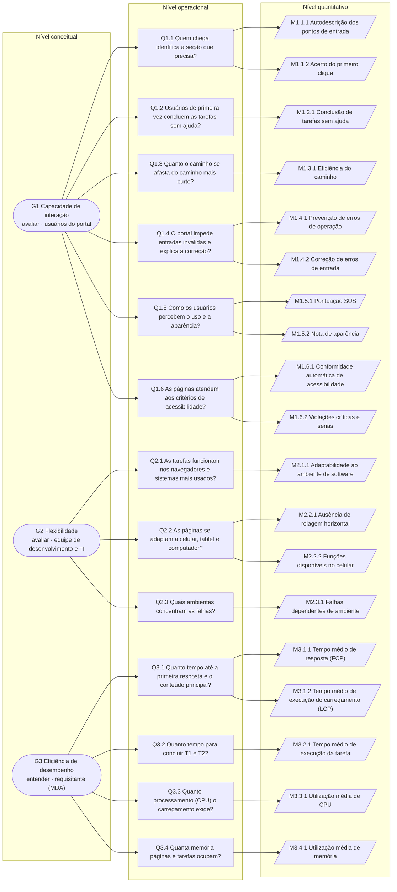

# Gráfico GQM

O gráfico mostra a hierarquia completa da modelagem GQM nos três níveis definidos por Basili,
Caldiera e Rombach (1994): o **conceitual**, com os [objetivos de medição](objetivos.md); o
**operacional**, com as [questões](questoes.md); e o **quantitativo**, com as
[métricas](metricas.md). Cada métrica responde a uma única questão, e cada questão pertence a
um único objetivo, o que mantém a rastreabilidade pelos identificadores (por exemplo,
G3 → Q3.1 → M3.1.1).

*Figura 1: Hierarquia GQM da avaliação do SIT. Elaborada pela equipe.*

**Legenda:**

| Forma | Nível GQM | Conteúdo |
|---|---|---|
| Retângulo arredondado | Conceitual | Objetivo de medição, com o propósito (avaliar ou entender) e o ponto de vista |
| Retângulo | Operacional | Questão, resumida; o texto completo está em [Questões](questoes.md) |
| Paralelogramo | Quantitativo | Métrica, com o nome da ficha em [Métricas](metricas.md) |

| Objetivo | Questões | Métricas |
|---|---|---|
| G1 Capacidade de interação | 6 | 10 |
| G2 Flexibilidade | 3 | 4 |
| G3 Eficiência de desempenho | 4 | 5 |
| **Total** | **13** | **19** |

??? info "Versão em texto do gráfico"

    - **G1 Capacidade de interação** (avaliar, do ponto de vista dos usuários do portal)
        - Q1.1 Reconhecibilidade de adequação: M1.1.1 Autodescrição dos pontos de entrada;
          M1.1.2 Acerto do primeiro clique
        - Q1.2 Apreensibilidade: M1.2.1 Conclusão de tarefas sem ajuda
        - Q1.3 Operabilidade: M1.3.1 Eficiência do caminho
        - Q1.4 Proteção contra erros do usuário: M1.4.1 Prevenção de erros de operação;
          M1.4.2 Correção de erros de entrada
        - Q1.5 Engajamento do usuário: M1.5.1 Pontuação SUS; M1.5.2 Nota de aparência
        - Q1.6 Assistência ao usuário: M1.6.1 Conformidade automática de acessibilidade;
          M1.6.2 Violações críticas e sérias
    - **G2 Flexibilidade** (avaliar, do ponto de vista da equipe de desenvolvimento e TI)
        - Q2.1 Adaptabilidade (ambiente de software): M2.1.1 Adaptabilidade ao ambiente de
          software
        - Q2.2 Adaptabilidade (ambiente de hardware): M2.2.1 Ausência de rolagem horizontal;
          M2.2.2 Funções disponíveis no celular
        - Q2.3 Adaptabilidade: M2.3.1 Falhas dependentes de ambiente
    - **G3 Eficiência de desempenho** (entender, do ponto de vista do requisitante)
        - Q3.1 Comportamento temporal: M3.1.1 Tempo médio de resposta (FCP); M3.1.2 Tempo
          médio de execução do carregamento (LCP)
        - Q3.2 Comportamento temporal: M3.2.1 Tempo médio de execução da tarefa
        - Q3.3 Utilização de recursos: M3.3.1 Utilização média de CPU
        - Q3.4 Utilização de recursos: M3.4.1 Utilização média de memória

## Referências

BASILI, V. R.; CALDIERA, G.; ROMBACH, H. D. The goal question metric approach. In: MARCINIAK, J. J. (ed.). **Encyclopedia of software engineering**. New York: Wiley, 1994. p. 528-532.
