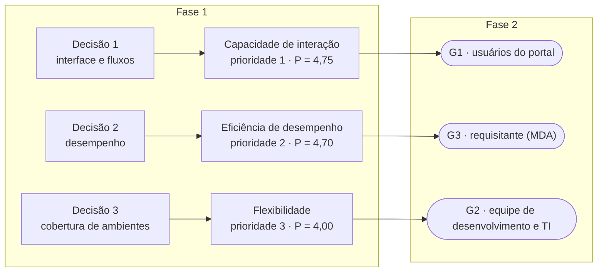

# Fase 2 — Modelagem GQM

Nesta fase, as características selecionadas na [Fase 1](../fase-1/index.md) são desdobradas
com a abordagem **GQM (Goal–Question–Metric)**, que organiza a medição em três níveis:

| Nível | Elemento | Páginas |
|---|---|---|
| Conceitual | Objetivos de medição | [Objetivos](objetivos.md) |
| Operacional | Questões e hipóteses | [Questões](questoes.md) e [hipóteses](hipoteses.md) |
| Quantitativo | Métricas, níveis de pontuação e critérios de julgamento | [Métricas](metricas.md) e [níveis de pontuação](niveis-pontuacao.md) |

A visão completa da hierarquia está no [Gráfico GQM](grafico-gqm.md).

## Objetivos e identificadores

Cada característica selecionada na Fase 1, segundo a ISO/IEC 25010:2023, gera um objetivo de
medição. Questões, hipóteses e métricas recebem o número do objetivo para manter a
rastreabilidade.

| Objetivo | Característica (ISO/IEC 25010:2023) | Questões | Hipóteses | Métricas |
|---|---|---|---|---|
| G1 | Capacidade de interação | Q1.x | H1.x | M1.x.y |
| G2 | Flexibilidade | Q2.x | H2.x | M2.x.y |
| G3 | Eficiência de desempenho | Q3.x | H3.x | M3.x.y |

## Rastreabilidade entre a Fase 1 e a Fase 2

Os objetivos de medição não foram escolhidos de forma independente: cada elemento do *template*
GQM vem de uma decisão registrada na [Fase 1](../fase-1/index.md). O foco da qualidade sai das
características priorizadas (seção 1.3) e das subcaracterísticas mantidas no modelo adaptado
(seção 4.2). O ponto de vista sai dos stakeholders (seção 2). O propósito sai das decisões do
requisitante (seção 1.2). O contexto sai do ambiente de uso (seção 3.3).

*Figura 1: Da decisão do requisitante ao objetivo de medição.*

| Objetivo | Característica e prioridade (seção 1.3) | Decisão do requisitante (seção 1.2) | Ponto de vista: stakeholder (seção 2) e critério de sucesso | Subcaracterísticas (seção 4.2) → questões | Contexto (seção 3.3) | ODS (seção 1.4) |
|---|---|---|---|---|---|---|
| [G1](objetivos.md#g1-capacidade-de-interacao) | Capacidade de interação, 1ª (P = 4,75) | 1. Quais telas e fluxos redesenhar | Colegiados e agentes territoriais ("encontrar a informação rapidamente") e agricultores familiares e cidadãos ("uso sem ajuda") | Reconhecibilidade de adequação → Q1.1; apreensibilidade → Q1.2; operabilidade → Q1.3; proteção contra erros do usuário → Q1.4; engajamento do usuário → Q1.5; assistência ao usuário → Q1.6 | Celular próprio, no interior, primeiro uso sem ajuda | 16.10 |
| [G2](objetivos.md#g2-flexibilidade) | Flexibilidade, 3ª (P = 4,00) | 3. Quais ambientes entram na matriz de testes do fornecedor | Equipe de desenvolvimento e TI do SIT ("defeitos reproduzíveis, com ambiente e passos") | Adaptabilidade → Q2.1 (software), Q2.2 (hardware) e Q2.3 (concentração de falhas) | Celulares Android e iPhone no campo; computadores Windows em escritórios | 9.c |
| [G3](objetivos.md#g3-eficiencia-de-desempenho) | Eficiência de desempenho, 2ª (P = 4,70) | 2. Se é preciso otimizar páginas e mapas para conexões móveis | Requisitante, MDA ("lista priorizada de melhorias apoiada em evidências") | Comportamento temporal → Q3.1 e Q3.2; utilização de recursos → Q3.3 e Q3.4 | Celular de entrada, rede móvel lenta, um usuário por vez | 9.c |

*Tabela 1: Rastreabilidade da Fase 1 para os objetivos da Fase 2. O detalhamento de cada
elemento está na seção "Ligação com a Fase 1" de cada objetivo, na página de
[objetivos](objetivos.md).*

### Verificação da consistência

A rastreabilidade foi conferida nos dois sentidos:

- **Da Fase 1 para a Fase 2:** as três decisões do requisitante têm um objetivo cada. As nove
  subcaracterísticas mantidas na seção 4.2 têm ao menos uma questão. Nenhuma subcaracterística
  excluída na seção 5.1 (por exemplo, capacidade, escalabilidade e inclusividade) aparece em
  questões ou métricas.
- **Da Fase 2 para a Fase 1:** as 13 questões e as 19 métricas pertencem a uma subcaracterística
  da seção 4.2. As páginas e tarefas de cada objetivo são as da seção 3.6. Os três pontos de vista
  são stakeholders da seção 2.
- **Stakeholders sem objetivo próprio:** gestores públicos e organizações sociais não são ponto
  de vista de nenhum objetivo, mas o critério de sucesso deles ("dados acessíveis e baixáveis")
  é coberto pela tarefa T3 de G1 e pelos tempos de carregamento de G3. A própria equipe
  avaliadora não é ponto de vista, porque não usa o resultado para decidir sobre o produto.
- **Dois propósitos diferentes:** G1 e G2 *avaliam*, porque apoiam decisões de redesenho e de
  cobertura de testes que exigem um julgamento. G3 busca *entender*, porque a decisão 2 pergunta
  primeiro *se* é preciso otimizar, e o comportamento do portal em rede móvel ainda não é
  conhecido.

**Situação da revisão cruzada:** **pendente**. Antes de encerrar a
[issue #11](https://github.com/FCTE-Qualidade-de-Software-1/2026-2_T02_DOROTHY_JOHSON/issues/11),
o outro responsável deve registrar no PR que conferiu a tabela.
