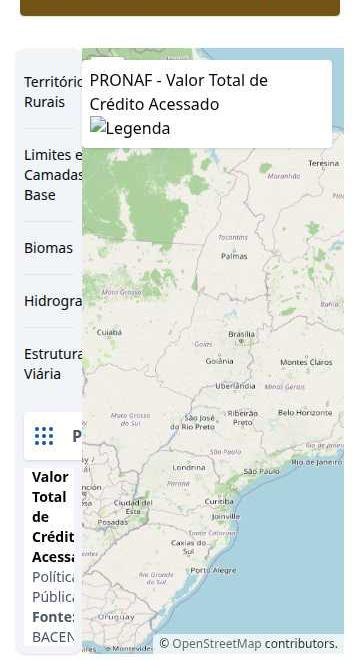
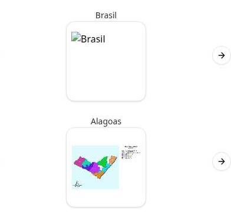

# Análise e respostas GQM: flexibilidade

Esta análise responde a Q2.1, Q2.2, Q2.3 e ao objetivo G2 e confronta H2.1–H2.3, conforme a
[issue #77](https://github.com/FCTE-Qualidade-de-Software-1/2026-2_T02_DOROTHY_JOHSON/issues/77).
Os cálculos usam os dados disponíveis da #72, o
[método de flexibilidade](../fase-3/metodo-flexibilidade.md) e os
[níveis da F2](../fase-2/niveis-pontuacao.md#3-g2-flexibilidade).

!!! success "Matriz completa: G2 = 2,21 — Bom"
    As 18 tarefas dos seis ambientes foram concluídas. A coleta móvel e a coleta Windows
    estão documentadas no [registro da #72](https://github.com/FCTE-Qualidade-de-Software-1/2026-2_T02_DOROTHY_JOHSON/blob/main/data/fase-4/flexibilidade/README.md).
    A pontuação aplica a conferência de funções no aparelho prevista na F3. Nenhuma falha
    bloqueante dependente de ambiente foi reproduzida; o limitador da F2 não foi acionado.

## 1. Coleta e critérios de cálculo

| Etapa | Condições e cobertura | Evidência |
|---|---|---|
| A: rolagem horizontal | 15/11/2026, 20:24–20:38, horário de Brasília; Chrome 151.0.7922.108 em Linux, Playwright 1.48.2; 3 páginas × 5 larguras × 2 execuções = 30 registros | `rolagem.csv` e capturas |
| B: funções preservadas | Mesma sessão; 25 funções, em 1366 e 360 px, 2 execuções = 100 registros | `funcoes.csv` e capturas |
| C: tarefas na matriz | 24/11/2026, 00:56–01:21, horário de Brasília; 9 combinações móveis; sessão complementar Windows, cerca de 16:40–16:55, com mais 9 combinações | `execucoes.csv` e capturas |
| D: conferência e falhas | Chrome/Android real, 384 px: F01 confirmada; F02 e F03 não confirmadas. F04 reproduzida nos três ambientes móveis; F05 observada uma vez | `falhas.csv` e capturas |
| Referência da coleta manual | Chrome/Windows a 1366 px; capturas macOS mantidas como histórico | `referencia-downloads-1366-win-chrome.jpg` (F04) e `tarefa-win-chrome-t1-e1.jpg` (comparação visual de F05) |

*Tabela 1: Sessões e cobertura. Os arquivos estão em
[`data/fase-4/flexibilidade/`](https://github.com/FCTE-Qualidade-de-Software-1/2026-2_T02_DOROTHY_JOHSON/tree/main/data/fase-4/flexibilidade).*

Os resultados são classificados **por recorte**, antes da média dos pontos. A escala é
Insatisfatório (0), Aceitável (1), Bom (2) e Excelente (3); os limites são critérios da
equipe definidos na F2, não limites normativos da ISO. Valores ausentes não recebem zero
nem são tratados como sucesso. O arredondamento ocorre somente na apresentação.

Para reproduzir, na raiz do repositório:

```bash
python3 scripts/fase-4/flexibilidade/pontuar.py
python3 scripts/fase-4/consolidar.py --verificar
```

O primeiro comando gera `data/fase-4/flexibilidade/pontuacao.csv`; o segundo confere os
derivados consolidados. Após mudar os dados, executar `consolidar.py` sem `--verificar`
para atualizá-los. A conferência no aparelho é aplicada pelo cálculo, sem reescrever os
registros originais da emulação.

## 2. Resultados por questão

### Q2.1 As tarefas T1, T2 e T3 podem ser concluídas nos navegadores e sistemas operacionais mais usados pelo público?

**Resposta:** sim. T1, T2 e T3 foram concluídas nos seis ambientes previstos, com
**18/18 = 100%**. Isso não elimina dificuldades de uso: T3 foi concluída nos celulares
mesmo com a tabela de PTDRS cortada (F04).

| Ambiente | T1 | T2 | T3 | M2.1.1: concluídas/previstas no ambiente | Nível F2 |
|---|---|---|---|---|---|
| Chrome/Android | Concluída | Concluída | Concluída | 3/3 = 100% | Excelente (3) |
| Samsung Internet/Android | Concluída | Concluída | Concluída | 3/3 = 100% | Excelente (3) |
| Safari/iOS | Concluída | Concluída | Concluída | 3/3 = 100% | Excelente (3) |
| Chrome/Windows (referência prevista) | Concluída | Concluída | Concluída | 3/3 = 100% | Excelente (3) |
| Edge/Windows | Concluída | Concluída | Concluída | 3/3 = 100% | Excelente (3) |
| Firefox/Windows | Concluída | Concluída | Concluída | 3/3 = 100% | Excelente (3) |

*Tabela 2: M2.1.1, a partir de `execucoes.csv`. T1 consulta Chapada dos Veadeiros - GO;
T2 ativa PRONAF - Valor Total de Crédito Acessado; T3 abre/baixa o PTDRS de Estrada De Ferro - GO.*

O Android foi testado em um Galaxy S24+ (Android 17, 384 px), com Chrome 158.0.8127.42
e Samsung Internet 31.0.0.81; o Safari, em um iPhone 17 Pro Max (iOS 27.0.1, 440 px).
T1 no Safari foi refeita após erro de seleção do avaliador; o registro válido corresponde
ao território correto e não constitui falha do navegador.

**Cálculo e comparação:** M2.1.1 = tarefas concluídas / 3 por ambiente. A F2 atribui 3
pontos a 100%, 2 a ≥ 85% e < 100%, 1 a ≥ 2/3 e < 85%, e 0 a < 2/3.
O agregado é **18/18 = 100% (Excelente)**, com cobertura de **6/6 ambientes**.
M2.1.1 = (3 + 3 + 3 + 3 + 3 + 3) / 6 = **3,00 pontos**; Q2.1 = **3,00**.
O agregado geral é informativo e não entra novamente na média dos recortes.

Gabriel Augusto executou os testes Windows em 24/11, aproximadamente entre 16:40 e 16:55,
em Windows 10 22H2, com Chrome 157.0.8103.80, Edge 158.0.4370.33 e Firefox 161.0.
A largura de 1366 px foi definida pelo modo Responsive (1366 × 1221) de cada navegador.
As nove capturas estão associadas às linhas de `execucoes.csv`; versões e horários são
os declarados no pacote fornecido, e não medições realizadas por esta análise.

### Q2.2 As páginas se adaptam às telas de celular, tablet e computador sem perder conteúdo nem funções?

**Resposta:** a adaptação é **parcial**. Nas larguras de 768, 1366 e 1920 px não houve
rolagem horizontal nas três páginas. No celular, a Biblioteca Territorial apresenta
rolagem em 360 e 412 px e perde o acesso às setas da Mapoteca (BIB-05). Meu Território
mantém 12/12 funções; o SITGeo fica com 6/6 após a conferência no aparelho prevista no
método. Isso não comprova a preservação de todas as funções em todas as larguras: a
inspeção funcional comparou 360 com 1366 px, com conferência das perdas em 384 px.

**M2.2.1 — rolagem horizontal**

| Página | 360 px | 412 px | 768 px | 1366 px | 1920 px |
|---|:---:|:---:|:---:|:---:|:---:|
| Meu Território | Sem | Sem | Sem | Sem | Sem |
| SITGeo | Sem | Sem | Sem | Sem | Sem |
| Biblioteca Territorial | **Com** | **Com** | Sem | Sem | Sem |

*Tabela 3: Rolagem horizontal em `rolagem.csv`; resultados iguais nas duas execuções.*

São **13/15 = 86,7% sem rolagem**, nível **Aceitável (1)**: a F2 define 15 combinações
como Excelente, 14 como Bom, 12–13 como Aceitável e até 11 como Insatisfatório. Cada
combinação conta uma vez; a segunda execução confirma o resultado. Nenhuma precisou
da exceção para conteúdo bidimensional. As setas do carrossel da Biblioteca ultrapassam
a largura disponível: a borda direita chega a 377 px na tela de 360 px.

**M2.2.2 — funções preservadas, com conferência no aparelho**

| Página | Emulação em 360 px | Conferência no aparelho de referência | Resultado adotado | Nível F2 | Funções perdidas |
|---|---|---|---|---|---|
| Meu Território | 12/12 | Nenhuma perda para conferir | 12/12 = 100% | Excelente (3) | Nenhuma registrada |
| SITGeo | 4/6 | F02/GEO-05 e F03/GEO-04 não se repetiram em 384 px; funções reintegradas | 6/6 = 100% | Excelente (3) | Nenhuma após a conferência |
| Biblioteca Territorial | 6/7 | F01/BIB-05 confirmada em 384 px | 6/7 = 85,7% | Bom (2) | Setas do carrossel da Mapoteca (BIB-05) |

*Tabela 4: `funcoes.csv`, reconciliado com `confirmada_no_aparelho` em `falhas.csv` pela
[seção 4.4 do método](../fase-3/metodo-flexibilidade.md#44-confirmacao-no-celular-de-referencia).*

A F2 atribui 3 pontos a 100% das funções, 2 a ≥ 80% e < 100%, 1 a ≥ 60% e < 80%,
e 0 a < 60%. Portanto:

- **M2.2.2 = (3 + 3 + 2) / 3 = 8/3 ≈ 2,67 pontos**, média dos níveis das páginas.
- **Q2.2 = (1 + 8/3) / 2 = 11/6 ≈ 1,83 pontos**. A pontuação anterior de 1,50
  desconsiderava a conferência de F02 e F03.

A reintegração não apaga a observação de 15/11 em 360 px nem prova correção nessa largura:
a verificação real ocorreu em outra data, versão e largura. No aparelho, o painel de
camadas abriu como gaveta larga e os botões de zoom ficaram livres. Aplica-se a regra já
prevista na F3, com essa ressalva.

<div class="grid" markdown>





</div>

*Figura 1: Evidências históricas da emulação. A perda da Biblioteca foi confirmada; as duas
do SITGeo não foram confirmadas no aparelho. A captura de página inteira da Biblioteca
tem 392 px porque inclui o conteúdo que transborda os 360 px.*

A conferência está nas capturas de
[GEO-04 no aparelho](https://github.com/FCTE-Qualidade-de-Software-1/2026-2_T02_DOROTHY_JOHSON/blob/main/data/fase-4/flexibilidade/capturas/f03-and-chrome-384.jpg),
[T2 e zoom](https://github.com/FCTE-Qualidade-de-Software-1/2026-2_T02_DOROTHY_JOHSON/blob/main/data/fase-4/flexibilidade/capturas/tarefa-and-chrome-t2-e1.jpg) e
[F01 na Mapoteca](https://github.com/FCTE-Qualidade-de-Software-1/2026-2_T02_DOROTHY_JOHSON/blob/main/data/fase-4/flexibilidade/capturas/f01-and-chrome-384.jpg).

### Q2.3 Quais ambientes concentram as falhas e, por isso, devem ter prioridade na matriz de testes do fornecedor?

**Resposta:** entre os ambientes executados, **Chrome/Android tem mais falhas graves
registradas (duas)**; Samsung Internet/Android e Safari/iOS têm uma cada. Todas as quatro
ocorrências reproduzidas estão na **Biblioteca Territorial**, em larguras de celular.
Não há evidência de concentração no Safari ou no SITGeo após a conferência no aparelho.
Edge e Firefox no Windows não tiveram falhas dependentes de ambiente reproduzidas na coleta.
Chrome/Windows é a referência para a comparação.

| Ambiente | Bloqueantes | Graves reproduzidas | Cosméticas reproduzidas | IDs contados | Nível F2 |
|---|---:|---:|---:|---|---|
| Chrome/Android, 384 px | 0 | 2 | 0 | F01, F04 | Aceitável (1) |
| Samsung Internet/Android, 384 px | 0 | 1 | 0 | F04 | Aceitável (1) |
| Safari/iOS, 440 px | 0 | 1 | 0 | F04 | Aceitável (1) |
| Edge/Windows, 1366 px | 0 | 0 | 0 | Nenhum | Excelente (3) |
| Firefox/Windows, 1366 px | 0 | 0 | 0 | Nenhum | Excelente (3) |

*Tabela 5: M2.3.1 a partir de `falhas.csv`. Chrome/Windows é a referência prevista e fica
fora dessa contagem, conforme o método da F3.*

Pela F2, ao menos uma bloqueante ou três graves implica 0; uma ou duas graves sem
bloqueantes implica 1; apenas cosméticas reproduzidas implica 2; nenhuma falha reproduzida
implica 3. Os três ambientes móveis recebem 1 ponto cada e Edge/Windows e Firefox/Windows recebem
3 pontos cada. **M2.3.1 = (1 + 1 + 1 + 3 + 3) / 5 = 1,80 pontos; Q2.3 = 1,80**.
A referência Windows mostra a tabela de PTDRS sem o corte observado nos celulares.
F05 permanece fora da contagem por falta de reprodução.

| Falha | Tratamento na análise | Justificativa e rastreabilidade |
|---|---|---|
| F01: setas da Mapoteca fora da tela | Grave, contada uma vez no AND-CHROME | Confirmada e reproduzida; os dois registros emulados (360/412 px) não criam falhas adicionais no ambiente |
| F02: zoom coberto no SITGeo | Excluída dos ambientes reais; GEO-05 reintegrada em M2.2.2 | `confirmada_no_aparelho = não`; conservada como observação da emulação |
| F03: dados da camada cobertos no SITGeo | Excluída dos ambientes reais; GEO-04 reintegrada em M2.2.2 | `confirmada_no_aparelho = não`; conservada como observação da emulação |
| F04: tabela de PTDRS cortada | Grave, contada uma vez em cada ambiente móvel | Reproduzida duas vezes nos três ambientes; T3 ainda foi concluída; duas capturas por ambiente |
| F05: aparência no modo escuro do Samsung Internet | Observação cosmética, fora da pontuação | Campo `reproduzida` vazio e apenas uma captura; exige repetição para contar em M2.3.1 |

*Tabela 6: Inclusões, exclusões e deduplicação. São dois IDs distintos contados (F01 e F04)
e quatro ocorrências ambiente × falha, não quatro defeitos distintos.*

**Prioridade para o fornecedor:** corrigir a tabela de PTDRS nos três ambientes móveis e
as setas da Mapoteca no Chrome/Android; incluir esses fluxos na regressão, mantendo as
larguras de 360 e 412 px e as larguras reais de 384 e 440 px. Verificar F01 também no
Samsung Internet e no Safari: não haver registro não prova ausência. Repetir F05 e
investigar a divergência de F02/F03 em 360 px são verificações adicionais. Manter Chrome, Edge e Firefox no Windows na regressão preserva a cobertura da matriz completa.

## 3. Classificação do G2

**Objetivo G2:** avaliar a flexibilidade do SIT quanto à adaptação a navegadores, sistemas
operacionais e telas, do ponto de vista da equipe de desenvolvimento e TI do fornecedor,
conforme a [definição da F2](../fase-2/objetivos.md#g2-flexibilidade).

| Questão | Métricas e cálculo | Pontos para consolidação | Resposta que sustenta G2 |
|---|---|---:|---|
| Q2.1 | M2.1.1 = média de seis níveis Excelente | 3,00 | T1–T3 concluídas nos seis ambientes |
| Q2.2 | M2.2.1 = 1; M2.2.2 = 8/3; média = 11/6 | 1,83 | Adaptação parcial, com rolagem e perda das setas na Biblioteca |
| Q2.3 | M2.3.1 = (1 + 1 + 1 + 3 + 3) / 5 | 1,80 | Falhas reproduzidas na Biblioteca em celulares; nenhuma registrada no Windows |
| **G2** | (3 + 11/6 + 9/5) / 3 = 199/90 | **2,21** | **Bom** |

*Tabela 7: Consolidação com pesos iguais por questão, sem arredondamento intermediário.*

- **Classificação pela média:** **Bom**, pois 2,00 ≤ 199/90 < 2,75.
- **Limitador de gravidade:** não acionado; nenhuma falha bloqueante dependente de ambiente
  foi reproduzida.
- **Classificação final:** **Bom**. O valor 2,10 do pacote original não incluía a conferência
  de F02/F03; após a correção, o valor é 2,21 e a classe continua Bom.

**Resposta ao G2:** o SIT apresenta **flexibilidade Boa no recorte avaliado**, permitindo
concluir os três fluxos nos seis ambientes. A adaptação visual da Biblioteca Territorial
em celulares permanece incompleta. O fornecedor deve corrigir a tabela de PTDRS e as setas
da Mapoteca, mantendo a matriz móvel e Windows na regressão. A classe não significa
compatibilidade comprovada com todos os aparelhos, versões ou estados do portal.

## 4. Hipóteses

As hipóteses compostas são confrontadas por afirmação. Uma afirmação contradita impede
confirmar a hipótese inteira, mesmo que outras partes tenham apoio ou permaneçam sem dados.

| Hipótese da F2 | Afirmação confrontada | Resultado | Evidência |
|---|---|---|---|
| H2.1 | Todas as execuções em Chromium são concluídas | Confirmada nos ambientes Chromium avaliados | 12/12 tarefas em Chrome/Android, Samsung Internet/Android, Chrome/Windows e Edge/Windows |
| H2.1 | Safari/iOS e Firefox têm pelo menos uma falha, sobretudo em T2 | Refutada nos dois navegadores | Safari e Firefox concluíram 3/3 cada, inclusive T2 |
| H2.2 | Nenhuma página tem rolagem a partir de 768 px; ao menos uma tem em 360 px | Confirmada no recorte medido | 9/9 combinações sem rolagem em 768/1366/1920 px; Biblioteca com rolagem em 360 px |
| H2.2 | Meu Território e Biblioteca preservam todas as funções; só SITGeo perde funções | Refutada pelo resultado adotado | Meu Território 12/12, Biblioteca 6/7 e SITGeo 6/6 após conferência |
| H2.3 | Falhas se concentram no SITGeo e no Safari/iOS | Refutada no recorte executado | As quatro ocorrências graves estão na Biblioteca; Chrome/Android tem duas e Safari uma |
| H2.3 | Falhas se concentram nas larguras de celular | Confirmada no recorte avaliado | Ocorrências contadas em 384/440 px; nenhuma em Edge/Firefox a 1366 px; referência Chrome/Windows sem o corte da tabela |
| H2.3 | Chrome/Android não tem falhas bloqueantes | Confirmada no recorte executado | Zero bloqueantes; duas graves, com contorno |

*Tabela 8: Confronto com [H2.1–H2.3 da F2](../fase-2/hipoteses.md#g2-flexibilidade).*

**Vereditos:** **H2.1 refutada como formulada**, pela conclusão de todas as tarefas no
Safari e no Firefox, embora a parte sobre Chromium tenha sido confirmada; **H2.2 refutada
como formulada**, embora a previsão de rolagem tenha sido confirmada; **H2.3 refutada
quanto à concentração prevista no recorte executado**, com apoio parcial à ocorrência
em celulares e confirmação da ausência de bloqueantes no Chrome/Android testado.
Os vereditos se limitam às versões, aparelhos e tarefas registrados.

## 5. Outros achados e limitações

**Defeito geral observado em 15/11, fora de M2.3.1.** A imagem da legenda da camada ativa
do SITGeo foi registrada como vazia em 360 e 1366 px, com o texto alternativo "Legenda".
Como ocorreu nas duas larguras, foi tratada separadamente como achado geral da sessão,
sem atribuição a um ambiente da matriz. Não foi revalidada por esta análise.

- **Cobertura:** os seis ambientes previstos foram executados, com 18/18 conclusões.
  Um computador Windows e dois aparelhos móveis não representam todos os equipamentos
  ou versões do público. Não há resultado de Safari/macOS ou de navegadores Linux na
  matriz manual.
- **Sessões e avaliadores:** Tales executou a sessão móvel e Gabriel Augusto a sessão
  Windows. Os horários Windows são aproximados; o modelo específico do computador não
  foi informado. A largura foi definida em modo Responsive, em navegadores reais no Windows.
- **Referência:** Chrome/Windows complementa a comparação anterior em macOS. F04 tem
  captura própria da tabela; a comparação visual de F05 usa os Indicadores Gerais em T1.
- **Datas, versões e larguras diferentes:** a emulação ocorreu em 15/11, com Chrome 151
  e 360 px; a conferência em 24/11, com Chrome 158 e 384 px. Não se pode isolar se a
  divergência de F02/F03 decorre da largura, do navegador ou de alterações no portal.
- **Escopo funcional:** M2.2.2 verifica visibilidade, posição, sobreposição e possibilidade
  de clique, não toda a legibilidade ou todos os estados dinâmicos. A tabela cortada de
  F04 entra em M2.3.1, sem alterar retroativamente o inventário medido em 15/11.
- **Registros de falhas:** F01 foi confirmada apenas no Chrome/Android; não se presume
  seu comportamento nos demais navegadores. F05 ainda precisa de repetição.
- **Interpretação:** nove conclusões técnicas não representam taxa de sucesso de usuários
  de primeira vez nem evidência estatística de compatibilidade com toda a população.

*Análise atualizada em 24/11/2026 com os dados versionados; nenhuma nova coleta foi
realizada para produzir esta página.*

**Veja também:** [relações entre as características](relacoes-caracteristicas.md) ·
[classificação final](classificacao-final.md) · [oportunidades de melhoria](oportunidades-melhoria.md) ·
[visão geral da Fase 4](index.md)
