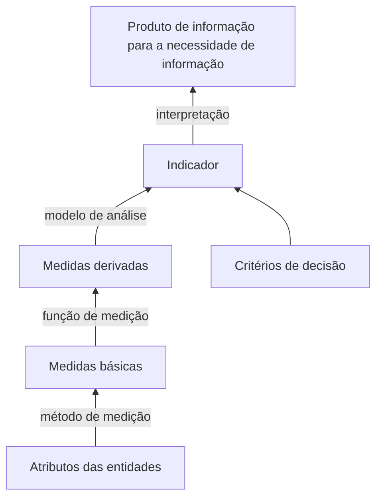

# Plano de Medição do Projeto (PSM/CID)

Este plano define como a equipe acompanha a execução do próprio projeto com métricas do
**PSM (Practical Software and Systems Measurement)**, conforme exigido na seção 2 do
enunciado. As medidas cobrem as três categorias pedidas: **Calendário e Progresso**,
**Recursos e Custos** e **Desempenho dos Processos**.

| Item | Valor |
|---|---|
| Abordagem | PSM, com o *Continuous Iterative Development (CID) Measurement Framework* v2.1 (2021) |
| Fonte dos dados | Quadro kanban do projeto no GitHub (issues, campos `Status`, `Estimate` e `Horas`) e pull requests do repositório |
| Coleta | Automática e diária (GitHub Actions), com snapshot em CSV em [`data/psm/`](https://github.com/FCTE-Qualidade-de-Software-1/2026-2_T02_DOROTHY_JOHSON/tree/main/data/psm) |
| Interpretação | Semanal, registrada no registro de medições (issue #20) e em ata (issue #18) |
| Início da medição | 20/10/2026 |

---

## 1. Fundamentação

O PSM é uma abordagem de medição **dirigida por necessidades de informação**: mede-se para
apoiar decisões de gestão, e não por medir. Ele se apoia em dois modelos complementares: o
**modelo de informação**, que organiza as medidas até a resposta à necessidade de informação, e
o **modelo de processo**, que descreve as atividades de medição (Aula 09; McGarry et al., 2002).

O modelo de informação, também adotado pela ISO/IEC/IEEE 15939, encadeia os elementos abaixo:

*Figura 1: Modelo de informação do PSM, adaptado da Aula 09.*

O **CID Measurement Framework** é a versão do PSM para desenvolvimento contínuo e iterativo.
A Parte 1 traz a **Tabela ICM** (*Information Category – Measurable Concept – Measures*), usada
aqui para escolher **o que medir**, e a Parte 2 traz as **especificações de medidas**, usadas
como modelo das fichas da Seção 4 (**como medir**).

---

## 2. Necessidades de informação da equipe

| ID | Necessidade de informação | Decisão apoiada |
|---|---|---|
| NI1 | Vamos concluir o trabalho planejado para cada entrega no prazo? | Replanejar ou redistribuir issues |
| NI2 | Quanto esforço cada entrega está custando à equipe? | Ajustar o escopo restante; compor a tabela de contribuição (#33) |
| NI3 | Nossas estimativas de tamanho estão coerentes com o esforço real? | Reestimar as issues abertas |
| NI4 | O trabalho flui ou fica parado em execução ou em revisão? | Acionar responsáveis e revisores; reduzir trabalho em andamento |

---

## 3. Seleção das medidas (Tabela ICM)

| Categoria de informação | Linha da Tabela ICM (CID Parte 1, Tabela 5) | Conceito mensurável | Medida adotada | NI |
|---|---|---|---|---|
| Calendário e Progresso | 1 | *Work Unit Progress / Milestone Completion* | M1: % concluído e burndown de pontos | NI1 |
| Recursos e Custos | 7 | *Financial Performance* (Cost, Effort) | M2: esforço em horas | NI2 |
| Recursos e Custos | 9 | *Financial Performance* (Estimation Accuracy) | M3: horas por ponto | NI3 |
| Desempenho dos Processos | 30 e 32 | *Process Efficiency – Speed* | M4: lead time e tempo de revisão de PR | NI4 |

As medidas foram escolhidas pelos critérios da Aula 09: relevância para as necessidades de
informação, viabilidade e baixo custo de coleta (os dados já existem no GitHub, exceto as horas)
e baixo grau de intrusão nas tarefas da equipe.

---

## 4. Fichas das medidas

### M1: % concluído e burndown de pontos

| Campo | Especificação |
|---|---|
| Necessidade de informação | NI1. O trabalho planejado para a entrega será concluído no prazo? |
| Categoria de informação | Calendário e Progresso |
| Conceito mensurável | *Work Unit Progress* |
| Entidades e atributos | Issues da milestone da entrega; atributos `Estimate` (pontos) e `Status` |
| Medidas básicas | MB1: pontos planejados na entrega (soma de `Estimate` das issues da milestone). MB2: pontos concluídos (soma de `Estimate` das issues em `Done`) |
| Medidas derivadas | MD1: % concluído = MB2 × 100 / MB1. MD2: pontos restantes por dia = MB1 − MB2 |
| Indicador | Burndown: linha de pontos restantes por dia comparada com a linha ideal (redução linear de MB1 até zero na data da entrega), com o % concluído acumulado |
| Modelo de análise | O desvio é a diferença percentual entre os pontos restantes reais e os da linha ideal no mesmo dia |
| Critérios de decisão | Desvio de 5% ou vários dias sem redução de pontos abertos: a equipe revisa os impedimentos. Desvio acima de 10%: a equipe considera replanejar (redistribuir issues ou mudar o compromisso). **Fonte:** CID Parte 2, especificações 8.2 (*Burndown*) e 8.3 (*Committed vs Completed*) |
| Procedimento de coleta | Automático e diário pelo script `scripts/psm/coletar.sh` |
| Procedimento de análise | Semanal, na reunião da equipe; resultado e decisão registrados na issue #20 e em ata |

### M2: Esforço em horas

| Campo | Especificação |
|---|---|
| Necessidade de informação | NI2. Quanto esforço cada entrega está custando? |
| Categoria de informação | Recursos e Custos |
| Conceito mensurável | *Financial Performance* (custo expresso em esforço) |
| Entidades e atributos | Issues concluídas; atributos `Horas`, responsáveis e data de fechamento |
| Medidas básicas | MB3: horas registradas por issue |
| Medidas derivadas | MD3: horas por membro por semana. MD4: horas totais por entrega |
| Indicador | Barras de horas por membro por semana e total acumulado por entrega |
| Modelo de análise | Comparação da distribuição de esforço entre semanas e entre membros. Cada issue tem um único responsável (regra 3 da Seção 5), que recebe integralmente as horas registradas nela |
| Critérios de decisão | Medida informativa, sem limite de decisão: não há na literatura usada um limite aplicável a esta medida. Os dados alimentam a tabela de contribuição (#33) |
| Procedimento de coleta | O responsável preenche o campo `Horas` ao mover a issue para `Done`; snapshot diário automático |
| Procedimento de análise | Semanal, junto com M1 |

### M3: Horas por ponto

| Campo | Especificação |
|---|---|
| Necessidade de informação | NI3. As estimativas de tamanho estão coerentes com o esforço real? |
| Categoria de informação | Recursos e Custos |
| Conceito mensurável | *Financial Performance* (*Estimation Accuracy*) |
| Entidades e atributos | Issues concluídas com `Estimate` e `Horas` preenchidos |
| Medidas básicas | MB3 (horas por issue) e MB4: pontos por issue (`Estimate`) |
| Medidas derivadas | MD5: horas por ponto na semana = soma de MB3 / soma de MB4 das issues concluídas na semana |
| Indicador | Linha semanal de horas por ponto |
| Modelo de análise | Variação percentual de MD5 em relação à semana anterior |
| Critérios de decisão | Variação de ±10%: a equipe analisa as causas na reunião e reestima as issues abertas, se necessário |
| Procedimento de coleta | Derivada dos mesmos dados de M1 e M2 |
| Procedimento de análise | Semanal, a partir da segunda semana com dados |

!!! warning "Critério adaptado"
    O CID lista *Estimation Accuracy* na Tabela ICM (linha 9), mas não especifica critério de
    decisão para essa medida. O limite de ±10% é uma **adaptação por analogia** à especificação
    8.10 (*Team Velocity*), que manda analisar variações de ±10% na velocidade. Horas por ponto é
    o inverso da produtividade da equipe, por isso o mesmo limite foi adotado.

### M4: Lead time e tempo de revisão de PR

| Campo | Especificação |
|---|---|
| Necessidade de informação | NI4. O trabalho flui ou fica parado em execução ou em revisão? |
| Categoria de informação | Desempenho dos Processos |
| Conceito mensurável | *Process Efficiency – Speed* |
| Entidades e atributos | Issues (datas de criação e fechamento) e pull requests (datas de abertura e merge) |
| Medidas básicas | Datas de criação e fechamento da issue; datas de abertura e merge do PR |
| Medidas derivadas | MD6: lead time = fechamento − criação da issue. MD7: tempo de revisão = merge − abertura do PR |
| Indicador | Gráfico de lead time por issue e de tempo de revisão por PR, com a linha da média |
| Modelo de análise | Comparação de cada item com a média do período |
| Critérios de decisão | Cada item mais de 10% acima da média é investigado para identificar a causa (impedimento, revisão parada, issue grande demais). **Fonte:** CID Parte 2, especificação 8.5 (*Cycle Time / Lead Time*) |
| Procedimento de coleta | Automático e diário pelo script `scripts/psm/coletar.sh` (CSV de itens e CSV de PRs) |
| Procedimento de análise | Semanal, junto com M1 |

---

## 5. Regras de coleta

1. **Pontos:** cada issue recebe uma estimativa no campo `Estimate` em escala de Fibonacci
   (1, 2, 3, 5, 8), dada pelo **responsável** da issue. Issues que passariam de 8 pontos devem ser
   quebradas em issues menores.
2. **Horas:** ao mover a issue para `Done`, o responsável preenche o campo numérico `Horas` com
   o esforço total gasto nela.
3. **Um responsável por issue:** trabalho dividido entre membros deve ser quebrado em
   sub-issues, cada uma com um único responsável e suas próprias `Horas`.
4. **Preenchimento retroativo:** cada responsável preenche `Estimate` e `Horas` das próprias
   issues abertas ou concluídas antes do início da medição.
5. **Snapshot diário:** o workflow `.github/workflows/psm-coleta.yml` roda todos os dias às
   23:00 de Brasília (02:00 UTC) e versiona dois arquivos em `data/psm/`:
     - `AAAA-MM-DD.csv`: um registro por item do kanban;
     - `prs-AAAA-MM-DD.csv`: um registro por pull request.

   A data do arquivo segue o fuso de Brasília. O workflow também pode ser disparado
   manualmente. O token usado tem apenas o escopo `read:project`.
6. **Interpretação:** semanalmente a equipe gera os indicadores a partir dos CSVs, compara com
   os critérios de decisão e registra interpretação e decisões no registro da issue #20 e na ata
   da reunião (#18).

---

## 6. Plano de análise

| Indicador | Medidas | Forma de apresentação |
|---|---|---|
| Burndown da entrega | M1 | Linha de pontos restantes por dia × linha ideal |
| % concluído | M1 | Valor acumulado no registro semanal |
| Esforço por membro | M2 | Barras de horas por membro por semana |
| Precisão da estimativa | M3 | Linha de horas por ponto por semana |
| Fluxo de trabalho | M4 | Pontos de lead time por issue e de tempo de revisão por PR, com a linha da média |

---

## 7. Limitações

- A medição começou em **20/10/2026**. Os dados anteriores dependem do preenchimento
  retroativo de cada responsável e de as datas registradas no GitHub refletirem o trabalho real.
- As **horas são autodeclaradas** e podem ter imprecisão.
- O kanban guarda apenas o estado atual; a evolução no tempo só existe a partir dos snapshots
  diários.
- O critério de M3 é uma adaptação, sem especificação própria no CID.

---

## Referências

- RAMOS, C. S. *Medição Prática de Software e Sistemas: PSM*. Aula 09, Qualidade de Software 1, FCTE/UnB, 2026.
- PSM. *Continuous Iterative Development Measurement Framework*, Part 1: Concepts, Definitions, Principles, and Measures, v2.1, 15 abr. 2021. Disponível em: <http://www.psmsc.com/CIDMeasurement.asp>.
- PSM. *Continuous Iterative Development Measurement Framework*, Part 2: Measurement Specifications and Enterprise Measures, v2.1, 15 abr. 2021. Disponível em: <http://www.psmsc.com/CIDMeasurement.asp>.
- McGARRY, J. et al. *Practical Software Measurement: Objective Information for Decision Makers*. Boston: Addison-Wesley, 2002.
- ISO/IEC/IEEE. *ISO/IEC/IEEE 15939: Systems and software engineering — Measurement process*.
